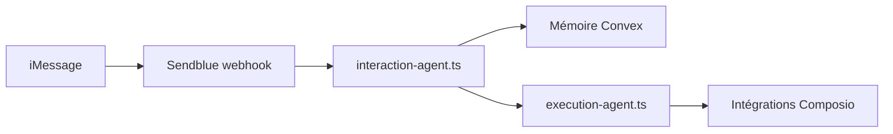

# raroque/boop-agent

> Template for a personal agent over iMessage, backed by your Claude Code or Codex subscription.

## The problem
A useful personal agent requires gluing together messaging, memory, scheduled tasks and integrations. Without a template, everything has to be written.

## What it actually does
A "dispatcher" agent receives your iMessages via Sendblue, recalls memory and launches sub-agents that do the work (web, Composio integrations). Memory has three levels, with daily consolidation. Every external action first goes through a draft to confirm. A React dashboard is used for debugging.

## How it is wired
Simplified diagram based on the fiche, no diagram provided.



## Trying it
```bash
git clone https://github.com/raroque/boop-agent.git
cd boop-agent
npm install
npm install -g @anthropic-ai/claude-code
claude
npm run setup
npm run dev
```

## Cost and gotchas
Claude Code or Codex subscription required; Sendblue, Convex and ngrok accounts (or an equivalent tunnel), Composio optional. The author says it himself: not optimized for cost or security.

## What it is not
Not a finished product: the author speaks of a starting point, never meant to be published. Not independent of third-party services: iMessage goes through Sendblue. The end of the README is truncated in the provided fiche.

## Alternatives
No alternative named in the README.

## For you
Worth watching: the dispatcher plus sub-agents plus memory architecture is instructive for an AI profile, but the author's security warning rules out entrusting it with sensitive data.
