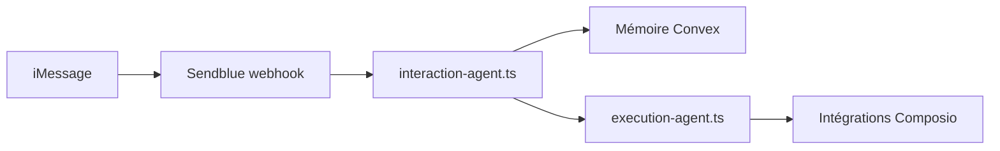

# raroque/boop-agent

> Modèle d'agent personnel par iMessage, adossé à ton abonnement Claude Code ou Codex.

## Le problème
Un agent perso utile demande de coller ensemble messagerie, mémoire, tâches planifiées et intégrations. Sans gabarit, tout est à écrire.

## Ce que ça fait vraiment
Un agent « dispatcher » reçoit tes iMessages via Sendblue, rappelle la mémoire et lance des sous-agents qui font le travail (web, intégrations Composio). La mémoire est à trois niveaux, avec consolidation quotidienne. Toute action externe passe d'abord par un brouillon à confirmer. Un tableau de bord React sert au débogage.

## Comment c'est branché
Schéma simplifié d'après la fiche, sans diagramme fourni.



## Essayer
```bash
git clone https://github.com/raroque/boop-agent.git
cd boop-agent
npm install
npm install -g @anthropic-ai/claude-code
claude
npm run setup
npm run dev
```

## Coût et pièges
Abonnement Claude Code ou Codex obligatoire ; comptes Sendblue, Convex et ngrok (ou tunnel équivalent), Composio en option. L'auteur le dit lui-même : non optimisé pour le coût ni la sécurité.

## Ce que ce n'est pas
Pas un produit fini : l'auteur parle d'un point de départ, jamais prévu pour être publié. Pas autonome de tout service tiers : iMessage passe par Sendblue. La fin du README est tronquée dans la fiche fournie.

## Alternatives
Aucune alternative nommée dans le README.

## Pour toi
À surveiller : l'architecture dispatcher plus sous-agents plus mémoire est instructive pour un profil IA, mais l'avertissement sécurité de l'auteur interdit d'y confier des données sensibles.

