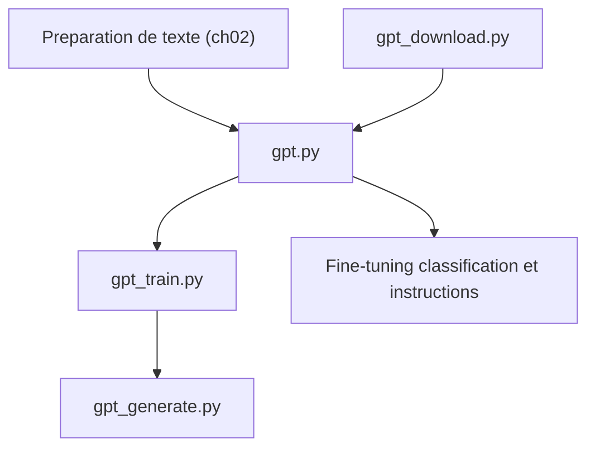

# rasbt/LLMs-from-scratch

> Code for coding, pre-training, and fine-tuning a GPT-type LLM step-by-step using PyTorch.

## The problem
Using LLMs through libraries hides their internal workings; it's difficult to understand them without rewriting the code.

## What it actually does
Notebooks and scripts by chapter: text preparation and BPE tokenizer, GPT model, pre-training, loading pre-trained weights, fine-tuning for classification and instruction following. A comprehensive bonus section covers KV cache, GQA, MoE, DPO, LoRA, Llama 3.2, Qwen3, Gemma 3, and evaluation/RLVR/GRPO.

## How it is wired


## Trying it
```bash
git clone --depth 1 https://github.com/rasbt/LLMs-from-scratch.git
```

## Cost and gotchas
Free; the main chapters are accessed on a laptop, and the GPU is used if available. The book and video course are paid. A license is present but not identified by GitHub: to be verified.

## What it is not
This is not a production library or a training framework; it is educational code. The trained model is small and intended for educational purposes.

## Alternatives
No alternative is specified in the README (it refers to a companion book on reasoning models).

## For you
Recommended: The best starting point for truly understanding LLMs before fine-tuning or optimizing, with executable code on a CPU.
