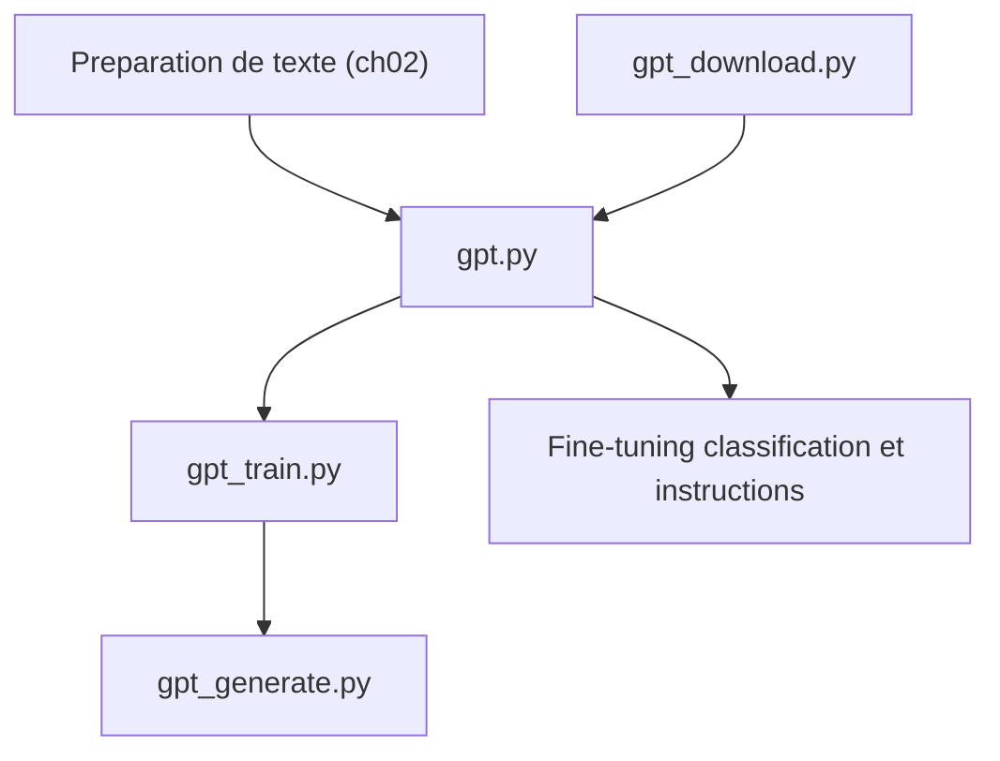

# rasbt/LLMs-from-scratch

> Code du livre pour coder, pré-entraîner et fine-tuner pas à pas un LLM de type GPT avec PyTorch.

## Le problème
Utiliser des LLM via des bibliothèques cache leur fonctionnement interne ; difficile de les comprendre sans les recoder.

## Ce que ça fait vraiment
Notebooks et scripts par chapitre : préparation de texte et tokenizer BPE, attention, modèle GPT, pré-entraînement, chargement de poids pré-entraînés, fine-tuning de classification et d'instructions. Un large matériel bonus couvre KV cache, GQA, MoE, DPO, LoRA, Llama 3.2, Qwen3, Gemma 3, évaluation et RLVR/GRPO.

## Comment c'est branché


## Essayer
```bash
git clone --depth 1 https://github.com/rasbt/LLMs-from-scratch.git
```

## Coût et pièges
Gratuit ; les chapitres principaux tournent sur un laptop, le GPU est utilisé s'il existe. Le livre et le cours vidéo sont payants. Licence présente mais non identifiée par GitHub : à vérifier.

## Ce que ce n'est pas
Pas une bibliothèque de production ni un framework d'entraînement : c'est du code pédagogique. Le modèle entraîné est petit, à but éducatif.

## Alternatives
Aucune alternative nommée dans le README (renvoie à un livre compagnon sur les modèles de raisonnement).

## Pour toi
À adopter : meilleure base pour comprendre réellement les LLM avant de fine-tuner ou d'optimiser, avec du code exécutable sur CPU.

