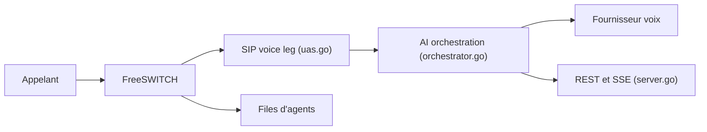

# rasonyang/ai-native-callcenter

> Open source call center where a voice model answers first and hands over to human agents.

## The problem
Traditional call centers bolt AI on as an option on top of voice menus and separate queues.

## What it actually does
- FreeSWITCH receives the call and connects it to an internal SIP leg; the audio goes speech-to-speech to a provider (qwen, doubao, openai, grok or a homemade gateway).
- A flow engine (phases, tools, transitions) guides the conversation and decides on the transfer to a `mod_callcenter` queue.
- Agents, supervisors, live dashboard, callbacks, outbound campaigns; a single record per call (transcript, recording on disk or S3).
- A Go binary with REST and SSE API, PostgreSQL and FreeSWITCH.

## How it is wired


## Trying it
```bash
curl -fsSL https://github.com/rasonyang/ai-native-callcenter/releases/latest/download/install.sh | sudo sh
make dev-up
cd web && npm install && npm run build && cd ..
make build
./bin/aicc useradd -username admin -password '…' -role ADMIN
go test -race ./...
```

## Cost and gotchas
The voice provider is billed to you; FreeSWITCH, PostgreSQL and the Chrome web-sip-phone extension (separate repo) are required for the agents. The installer is a `curl | sh`, to be read before running.

## What it is not
No built-in ASR+LLM+TTS pipeline: the README deliberately rules this out and points to cascade-realtime-gateway. Not a SaaS: everything is self-hosted.

## Alternatives
No alternative named in the README (cascade-realtime-gateway is a complement).

## For you
Worth watching: an interesting AI voice architecture, but developed by one person since August 2026 and demanding in telephony.
