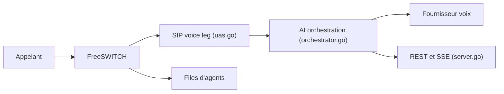

# rasonyang/ai-native-callcenter

> Centre d'appels open source où un modèle vocal répond d'abord et passe la main à des agents humains.

## Le problème
Les centres d'appels traditionnels ajoutent l'IA en option par-dessus des menus vocaux et des files d'attente séparées.

## Ce que ça fait vraiment
- FreeSWITCH reçoit l'appel et le relie à une jambe SIP interne ; l'audio part en speech-to-speech vers un fournisseur (qwen, doubao, openai, grok ou une passerelle maison).
- Un moteur de flux (phases, outils, transitions) guide la conversation et décide du transfert vers une file `mod_callcenter`.
- Agents, superviseurs, tableau de bord en direct, rappels, campagnes sortantes ; un seul enregistrement par appel (transcription, enregistrement sur disque ou S3).
- Un binaire Go avec API REST et SSE, PostgreSQL et FreeSWITCH.

## Comment c'est branché


## Essayer
```bash
curl -fsSL https://github.com/rasonyang/ai-native-callcenter/releases/latest/download/install.sh | sudo sh
make dev-up
cd web && npm install && npm run build && cd ..
make build
./bin/aicc useradd -username admin -password '…' -role ADMIN
go test -race ./...
```

## Coût et pièges
Fournisseur vocal facturé à ta charge ; FreeSWITCH, PostgreSQL et l'extension Chrome web-sip-phone (dépôt séparé) requis pour les agents. L'installeur est un `curl | sh`, à lire avant d'exécuter.

## Ce que ce n'est pas
Pas de pipeline ASR+LLM+TTS intégré : le README exclut cela volontairement et renvoie vers cascade-realtime-gateway. Pas un SaaS : tout s'héberge.

## Alternatives
Aucune alternative nommée dans le README (cascade-realtime-gateway est un complément).

## Pour toi
À surveiller : architecture voix IA intéressante, mais développée par une personne depuis août 2026 et exigeante en téléphonie.

