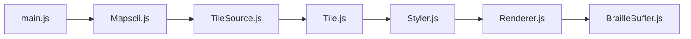

# rastapasta/mapscii

> World map viewer in Braille/ASCII for the terminal, in Node.js, for the curious.

## The problem
Viewing a vector map without a browser, for example on a server over SSH.

## What it actually does
Decodes vector tiles (remote server or local MBTiles), applies Mapbox styles, draws in Braille or ASCII blocks, with mouse (drag, zoom) and keyboard shortcuts. Public demo via telnet.

## How it is wired


## Trying it
```bash
telnet mapscii.me
npx mapscii
npm install -g mapscii
```

## Cost and gotchas
Free. Node.js >= 10; xterm-compatible terminal. Last push in November 2024.

## What it is not
Not a mapping tool for analysis: a playful demo. The README's TODO still lists GeoJSON, labels and rendering of large areas as not done.

## Alternatives
None named in the README.

## For you
Ignore: fun in a terminal but with no data/MLOps use, and little activity since late 2024.
