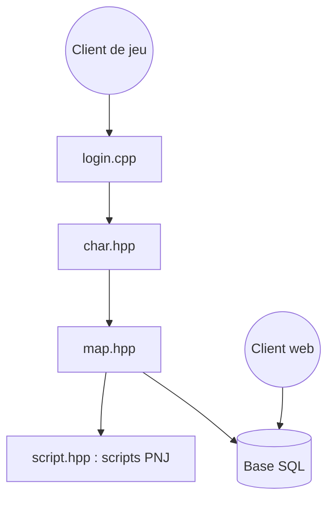

# rathena/rathena

> Massively multiplayer online game server in C++, for hosting your own MMORPG.

## The problem
Setting up an MMORPG server compatible with the existing client requires login, character and map services.

## What it actually does
Provides the login, character, inter-server and map services, with NPC scripts, skills, items and storage. Web endpoints handle guild emblems, merchant shops and party recruitment. Data is persisted in SQL (MySQL or MariaDB). The repository contains documentation of script commands.

## How it is wired

## Trying it
No command is documented in the README: installation is referred to per-system guides (Windows, CentOS, Debian, FreeBSD).

## Cost and gotchas
Free. MySQL or MariaDB 5+, gcc 6+ or Visual Studio 2017+ required. Minimal hardware: 1 core, 1 GB of RAM. The GPL-3.0 licence applies.

## What it is not
Not a game ready to play: it is a server, which requires the original game client, which the repository does not cover. 655 open issues.

## Alternatives
- eAthena: project of which rAthena is the continuation.

## For you
Ignore: game server unrelated to data, AI or MLOps work.
