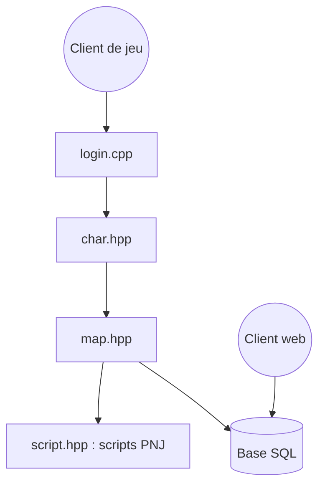

# rathena/rathena

> Serveur de jeu en ligne massivement multijoueur en C++, pour héberger son propre MMORPG.

## Le problème
Monter un serveur de MMORPG compatible avec le client existant demande des services de connexion, de personnages et de cartes.

## Ce que ça fait vraiment
Fournit les services login, personnages, inter-serveur et cartes (map), avec scripts de PNJ, compétences, objets et stockage. Des points d'accès web gèrent emblèmes de guilde, boutiques de marchands et recrutement de groupes. Les données sont persistées en SQL (MySQL ou MariaDB). Le dépôt contient une documentation de commandes de scripts.

## Comment c'est branché

## Essayer
Aucune commande n'est documentée dans le README : l'installation est renvoyée aux guides par système (Windows, CentOS, Debian, FreeBSD).

## Coût et pièges
Gratuit. Il faut MySQL ou MariaDB 5+, gcc 6+ ou Visual Studio 2017+. Matériel minimal : 1 cœur, 1 Go de RAM. La licence GPL-3.0 s'applique.

## Ce que ce n'est pas
Pas un jeu prêt à jouer : c'est un serveur, qui exige le client du jeu d'origine, dont le dépôt ne parle pas. 655 issues ouvertes.

## Alternatives
- eAthena : projet dont rAthena est la continuation.

## Pour toi
À ignorer : serveur de jeu sans lien avec un travail data, IA ou MLOps.

