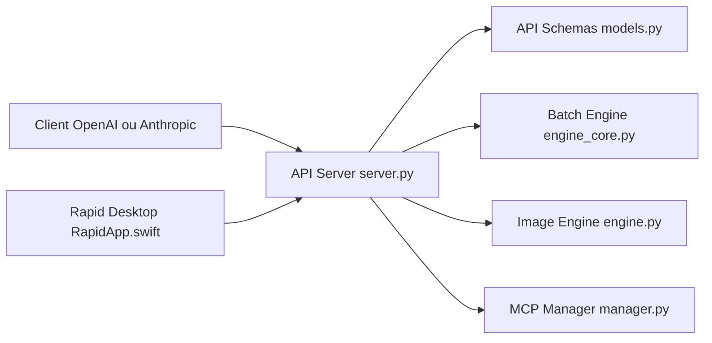

# raullenchai/Rapid-MLX

> Local inference server for Apple Silicon Macs, compatible with the OpenAI and Anthropic APIs, for devs and agents.

## The problem
Running LLMs, image generation or voice locally on a Mac means gluing together several tools, with clients that expect an OpenAI/Anthropic API.

## What it actually does
A `rapid-mlx` CLI (chat, serve, pull, recipe…) starts a server on `localhost:8000` with `/v1/chat/completions`, `/v1/messages`, `/v1/embeddings`, `/v1/audio/*`, `/v1/images/*`, `/v1/videos`. Pure MLX core with continuous batching and prompt cache. Extras add vision, audio, video, images. A `launch` command configures Claude Code, Cline or Continue. There is also a macOS Desktop app.

## How it is wired


## Trying it
```bash
brew install rapid-mlx
rapid-mlx chat
rapid-mlx serve qwen3.5-4b-4bit
rapid-mlx launch claude-code
```

## Cost and gotchas
M-series Mac required. First launch: ~3 GB of weights. Large models require 32 to 192+ GB of unified RAM. Image/video generation is serialized, minutes per second of video.

## What it is not
Not cross-platform (no Linux/Windows). The "3× Ollama" figures are the authors' own. License present but not identified by GitHub; model weights keep their own licenses.

## Alternatives
- Ollama: cited as the throughput reference.

## For you
Worth watching if you have a powerful Mac and want a local backend for your agents; first check the actual license and the dependence on a single maintainer.
