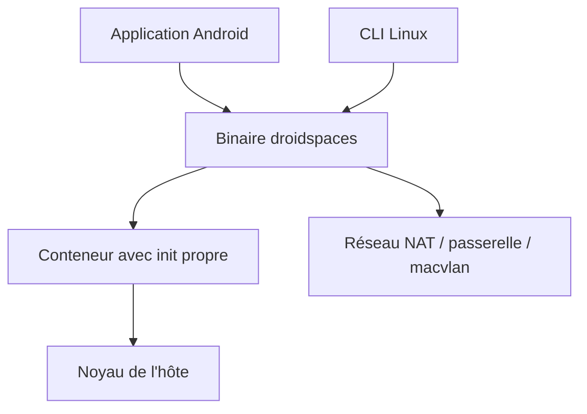

# ravindu644/Droidspaces-OSS

> Runs real Linux distributions in containers on a rooted Android phone or a Linux PC.

## The problem
Running a full Linux with its own init on Android normally requires a limited chroot or a slow virtual machine.

## What it actually does
A static binary under 400 KB starts containers with their own init (systemd, OpenRC...) on the host kernel, without emulation. It offers three network modes (NAT, OpenWrt gateway, macvlan), desktop with GPU and sound, hardware access and Docker or Podman inside. An Android application drives the binary.

## How it is wired
Simplified schema based on the sheet, no diagram provided.



## Trying it
```bash
sudo ./droidspaces check
```
On Android: install the APK, grant root, then create a container from the Containers tab.

## Cost and gotchas
Free. Rooted device and a kernel built with the right options (most stock kernels do not have them). On Linux: kernel 3.10 or later and root.

## What it is not
Not a virtual machine: the root of a hostile container can reach the host. Not a tool for untrusted code. No data / AI use documented.

## Alternatives
No alternative named; LXC is cited as an architectural inspiration.

## For you
Ignore: a rooted-Android tinkering tool, with no link to data / AI / MLOps work.
