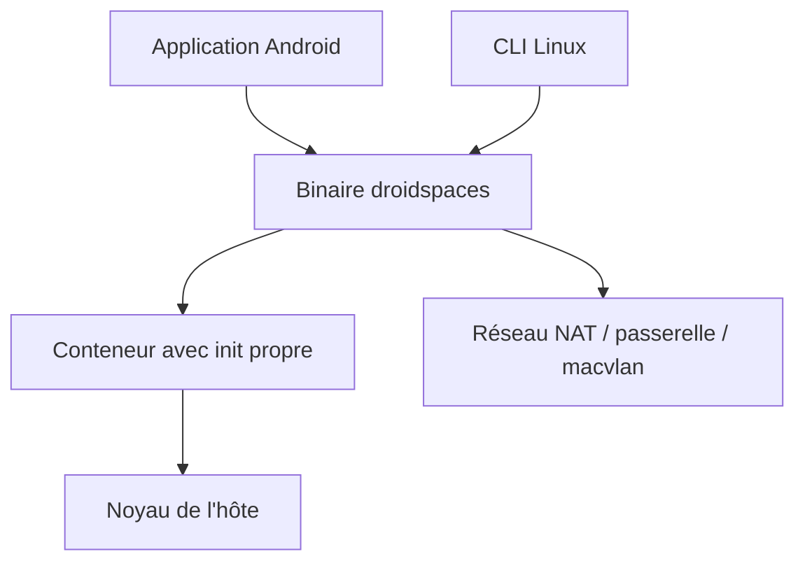

# ravindu644/Droidspaces-OSS

> Fait tourner de vraies distributions Linux en conteneurs sur un téléphone Android rooté ou un PC Linux.

## Le problème
Lancer un Linux complet avec son init sur Android demande normalement un chroot limité ou une machine virtuelle lente.

## Ce que ça fait vraiment
Un binaire statique de moins de 400 Ko démarre des conteneurs avec leur propre init (systemd, OpenRC...) sur le noyau de l'hôte, sans émulation. Il propose trois modes réseau (NAT, passerelle OpenWrt, macvlan), du bureau avec GPU et son, l'accès au matériel et Docker ou Podman dedans. Une application Android pilote le binaire.

## Comment c'est branché
Schéma simplifié d'après la fiche, sans diagramme fourni.



## Essayer
```bash
sudo ./droidspaces check
```
Sur Android : installer l'APK, accorder root, puis créer un conteneur depuis l'onglet Containers.

## Coût et pièges
Gratuit. Appareil rooté et noyau compilé avec les bonnes options (la plupart des noyaux d'origine les ont pas). Sous Linux : noyau 3.10 ou plus et root.

## Ce que ce n'est pas
Pas une machine virtuelle : la racine d'un conteneur hostile peut atteindre l'hôte. Pas un outil pour code non fiable. Aucun usage data / IA documenté.

## Alternatives
Aucune alternative nommée ; LXC est cité comme inspiration d'architecture.

## Pour toi
À ignorer : outil de bidouille Android rooté, sans lien avec un travail data / IA / MLOps.

