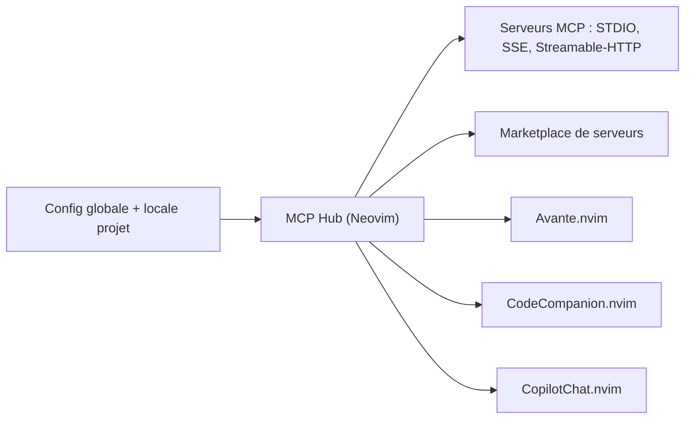

# ravitemer/mcphub.nvim

> MCP client for Neovim that plugs MCP servers into the editor's AI chat plugins.

## The problem
Each Neovim AI chat plugin requires its own MCP server configuration, with no common interface to manage, test or share them.

## What it actually does
The plugin manages MCP servers (tools, resources, resource templates, prompts) over STDIO, SSE and Streamable-HTTP transports, with OAuth (PKCE) or headers for remote servers. It exposes everything to Avante.nvim, CodeCompanion.nvim and CopilotChat.nvim. It reads global and project-local config (VS Code compatible, JSON5), offers a server marketplace and lets you write MCP servers in Lua. Roots and Sampling are not supported.

## How it is wired
Simplified diagram based on the sheet, no diagram provided.



## Trying it
```bash
# Aucune commande dans le README : renvoi vers le site de documentation
# pour l'installation et la configuration
```

## Cost and gotchas
Free. The connected MCP servers may have their own keys or quotas, and the plugin has no tests yet ("Add tests" box unchecked).

## What it is not
Not an AI chat: you already need one of the three chat plugins. It only serves those who live in Neovim. Installation and examples are not in the README, only on the documentation site.

## Alternatives
No alternative cited in the README.

## For you
Worth watching: interesting if you code in Neovim with an agent and MCP tools, useless otherwise; single maintainer and no tests, so test it before relying on it.
