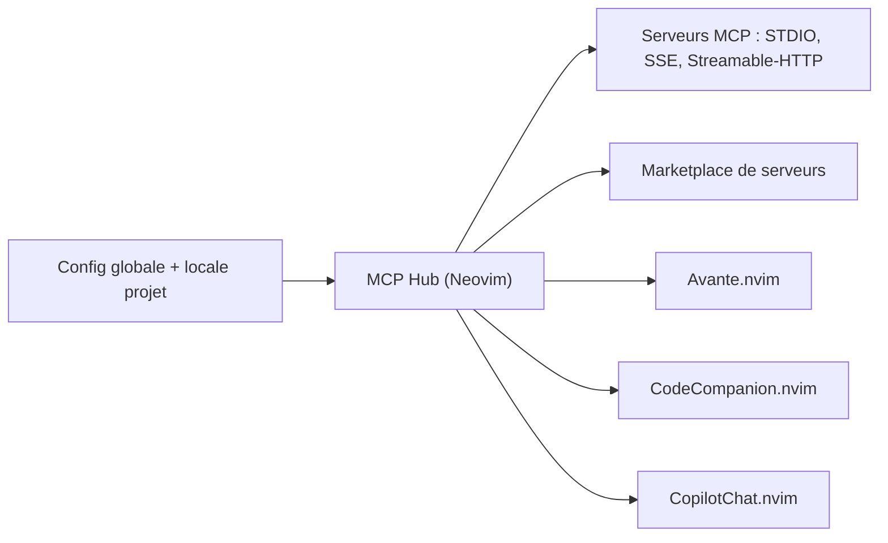

# ravitemer/mcphub.nvim

> Client MCP pour Neovim qui branche des serveurs MCP sur les plugins de chat IA de l'éditeur.

## Le problème
Chaque plugin de chat IA de Neovim demande sa propre configuration des serveurs MCP, sans interface commune pour les gérer, les tester ou les partager.

## Ce que ça fait vraiment
Le plugin gère des serveurs MCP (outils, ressources, modèles de ressources, prompts) en transports STDIO, SSE et Streamable-HTTP, avec OAuth (PKCE) ou en-têtes pour les serveurs distants. Il expose le tout à Avante.nvim, CodeCompanion.nvim et CopilotChat.nvim. Il lit la config globale et locale au projet (compatible VS Code, JSON5), propose une marketplace de serveurs et permet d'écrire des serveurs MCP en Lua. Roots et Sampling ne sont pas pris en charge.

## Comment c'est branché
Schéma simplifié d'après la fiche, sans diagramme fourni.



## Essayer
```bash
# Aucune commande dans le README : renvoi vers le site de documentation
# pour l'installation et la configuration
```

## Coût et pièges
Gratuit. Les serveurs MCP branchés peuvent avoir leurs propres clés ou quotas, et le plugin n'a pas encore de tests (case « Add tests » non cochée).

## Ce que ce n'est pas
Ce n'est pas un chat IA : il faut déjà un des trois plugins de chat. Il ne sert qu'à qui vit dans Neovim. Installation et exemples ne sont pas dans le README, seulement sur le site de documentation.

## Alternatives
Aucune alternative citée dans le README.

## Pour toi
À surveiller : intéressant si tu codes sous Neovim avec un agent et des outils MCP, inutile sinon ; mainteneur unique et pas de tests, donc à tester avant de t'y fier.

