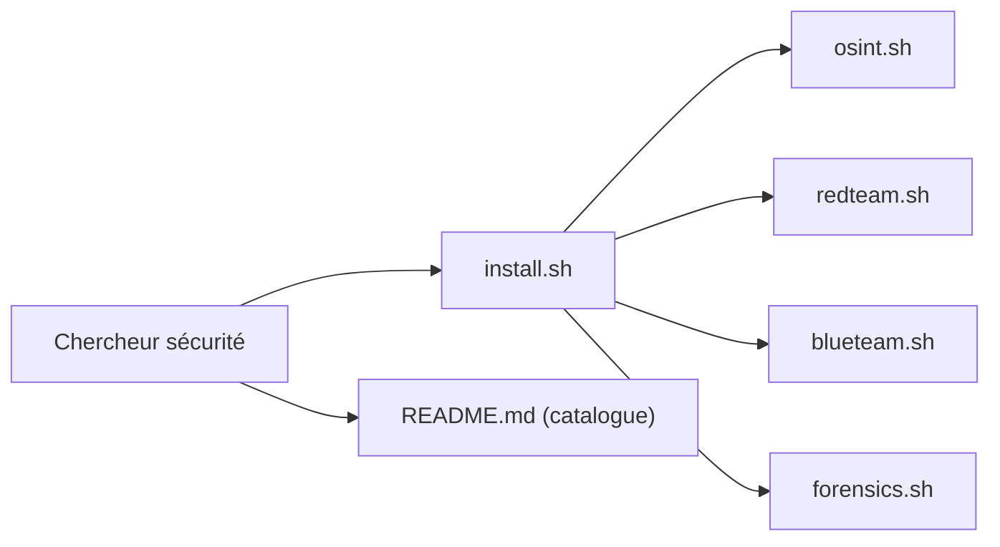

# rawfilejson/awesome-osint-arsenal

> Giant list of OSINT and offensive/defensive security tools, with per-stack installation scripts, for practitioners.

## The problem
Intelligence and security tools are scattered across repositories and services, with no grouped installation.

## What it actually does
A catalog of more than 750 tools in 50 categories (usernames, e-mail, phone, domains, geolocation, leaks, red team, blue team, forensics, hardware, labs, Georgian resources). Scripts (`install.sh`, `osint.sh`, `redteam.sh`, `blueteam.sh`, `forensics.sh`, `hardware.sh`, `labs.sh`, `termux.sh`) install through `apt`, `pip` or `go`. The tools are third-party: this repository does not contain their code.

## How it is wired


## Trying it
```bash
git clone https://github.com/rawfilejson/awesome-osint-arsenal
cd awesome-osint-arsenal
sudo bash osint.sh
```

## Cost and gotchas
The scripts require `sudo` and install intrusion tools (C2, credential extractors): read them before running, ideally in a Kali VM. The README also suggests a `curl | sudo bash`. The author warns that some sections will age without help.

## What it is not
Not a single tool and not collectively maintained. Contains phishing, credential dorks and IP trackers: lawful use only with written authorization. The "753+" count is self-declared.

## Alternatives
- jivoi/awesome-osint: the reference OSINT list.
- Z4nzu/hackingtool: all-in-one toolbox.
- cipher387/osint_stuff_tool_collection: a neighboring collection.

## For you
Ignore: a broad offensive surface installed with `sudo`, a single maintainer and perishable links; prefer a targeted list or a single audited tool.
