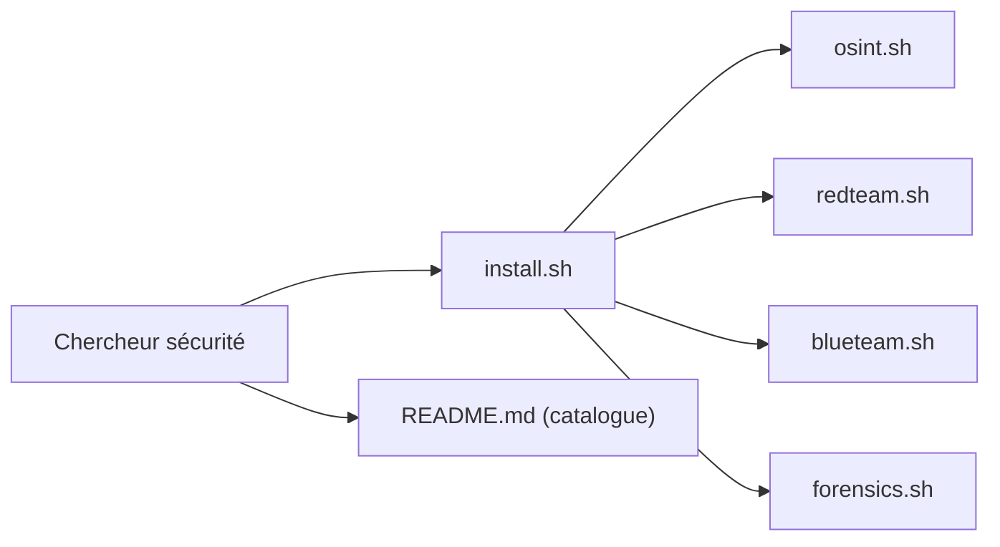

# rawfilejson/awesome-osint-arsenal

> Liste géante d'outils OSINT et sécurité offensive/défensive, avec scripts d'installation par pile, pour praticiens.

## Le problème
Les outils de renseignement et de sécurité sont dispersés entre dépôts et services, sans installation groupée.

## Ce que ça fait vraiment
Catalogue de plus de 750 outils en 50 catégories (usernames, e-mail, téléphone, domaines, géolocalisation, fuites, red team, blue team, forensique, hardware, labs, ressources géorgiennes). Des scripts (`install.sh`, `osint.sh`, `redteam.sh`, `blueteam.sh`, `forensics.sh`, `hardware.sh`, `labs.sh`, `termux.sh`) installent par `apt`, `pip` ou `go`. Les outils sont tiers : ce dépôt ne contient pas leur code.

## Comment c'est branché


## Essayer
```bash
git clone https://github.com/rawfilejson/awesome-osint-arsenal
cd awesome-osint-arsenal
sudo bash osint.sh
```

## Coût et pièges
Les scripts demandent `sudo` et installent des outils d'intrusion (C2, extracteurs d'identifiants) : à lire avant exécution, idéalement en VM Kali. Le README propose aussi un `curl | sudo bash`. L'auteur prévient que des sections vont vieillir sans aide.

## Ce que ce n'est pas
Pas un outil unique ni maintenu collectivement. Contient hameçonnage, dorks de credentials et traceurs d'IP : usage légal uniquement avec autorisation écrite. Le décompte « 753+ » est auto-déclaré.

## Alternatives
- jivoi/awesome-osint : liste OSINT de référence.
- Z4nzu/hackingtool : boîte à outils tout-en-un.
- cipher387/osint_stuff_tool_collection : collection voisine.

## Pour toi
À ignorer : surface offensive large installée en `sudo`, mainteneur unique et liens périssables ; préfère une liste ciblée ou un seul outil audité.

