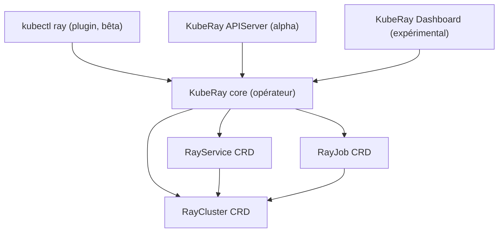

# ray-project/kuberay

> The official Kubernetes operator that runs Ray clusters as native resources.

## The problem
Running a Ray cluster on Kubernetes by hand means writing your own autoscaling, fault tolerance and zero-downtime updates for an inference service.

## What it actually does
Provides three CRDs: `RayCluster` (full lifecycle, autoscaling, fault tolerance), `RayJob` (creates a cluster, submits the job, can delete the cluster at the end) and `RayService` (RayCluster + Ray Serve graph, zero-downtime updates and high availability). Around them, three optional components: a `kubectl ray` plugin (beta since v1.3.0), an APIServer (alpha) and a dashboard (experimental since v1.4.0, announced as not yet ready for production). Integrates with Prometheus, Grafana, py-spy, Volcano, YuniKorn, Kueue, Nginx.

## How it is wired

## Trying it
No command documented in the README: it points to the RayCluster, RayJob and RayService quickstarts hosted in the Ray documentation.

## Cost and gotchas
Free, but you need a Kubernetes cluster and the GPUs that go with the workload. Since September 2023 all user documentation has moved to Ray: the repository only keeps the development docs, so reading here is not enough.

## What it is not
It is not Ray itself, nor a managed service: it is the orchestration layer. The dashboard and the APIServer are not at the same maturity level as the core: one is experimental, the other alpha. The examples are not in this repository.

## Alternatives
- Volcano / Apache YuniKorn / Kueue: cited as queueing systems, complementary rather than competing.
- Nothing else is named in the README as a substitute.

## For you
The obligatory route if your ML platform runs on Kubernetes and Ray is already your engine.
