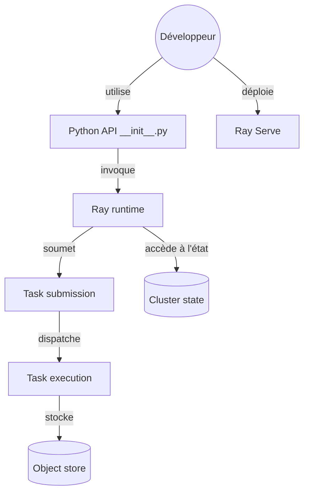

# ray-project/ray

> Python framework that takes code and AI workloads from a laptop to a cluster.

## The problem
A training run, a preprocessing job or a model service written for one machine no longer holds under load, and rewriting for a cluster is heavy.

## What it actually does
A distributed core with three abstractions: tasks (stateless functions), actors (stateful processes) and objects (shared immutable values). On top, five libraries: Data, Train, Tune, RLlib and Serve. A dashboard and a distributed debugger are used for observation. It runs on a single machine, a cloud or Kubernetes. APIs exist in Python, C++ and Java.

## How it is wired


## Trying it
```bash
pip install ray
```

## Cost and gotchas
Free, but the cluster, its machines and its GPUs are at your expense. The README only details installation via pip; configuration and deployment go through the documentation. The repo has more than 3,600 open issues.

## What it is not
It is not an orchestrator of scheduled data pipelines, nor a complete MLOps platform. It is not magic: performance depends on how the work is split.

## Alternatives
No alternative named in the README.

## For you
Adopt it as soon as training or model serving outgrows one machine: the standard, proven foundation of distributed computing in Python.
