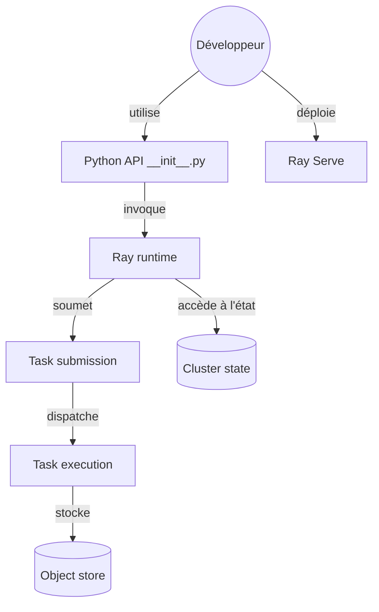

# ray-project/ray

> Framework Python qui fait passer du code et des charges IA d'un ordinateur portable à un cluster.

## Le problème
Un entraînement, un prétraitement ou un service de modèle écrit pour une machine ne tient plus la charge, et réécrire pour un cluster est lourd.

## Ce que ça fait vraiment
Un noyau distribué avec trois abstractions : tâches (fonctions sans état), acteurs (processus à état) et objets (valeurs immuables partagées). Par-dessus, cinq bibliothèques : Data, Train, Tune, RLlib et Serve. Un tableau de bord et un débogueur distribué servent à observer. Il tourne sur une machine, un cloud ou Kubernetes. Des API existent en Python, C++ et Java.

## Comment c'est branché


## Essayer
```bash
pip install ray
```

## Coût et pièges
Gratuit, mais le cluster, ses machines et ses GPU sont à ta charge. Le README ne détaille que l'installation par pip ; configuration et déploiement passent par la documentation. Le dépôt compte plus de 3 600 issues ouvertes.

## Ce que ce n'est pas
Ce n'est pas un orchestrateur de pipelines de données planifiés, ni une plateforme MLOps complète. Ce n'est pas magique : la performance dépend de la façon de découper le travail.

## Alternatives
Aucune alternative nommée dans le README.

## Pour toi
À adopter dès que l'entraînement ou le service de modèles dépasse une machine : base standard et éprouvée du calcul distribué en Python.

