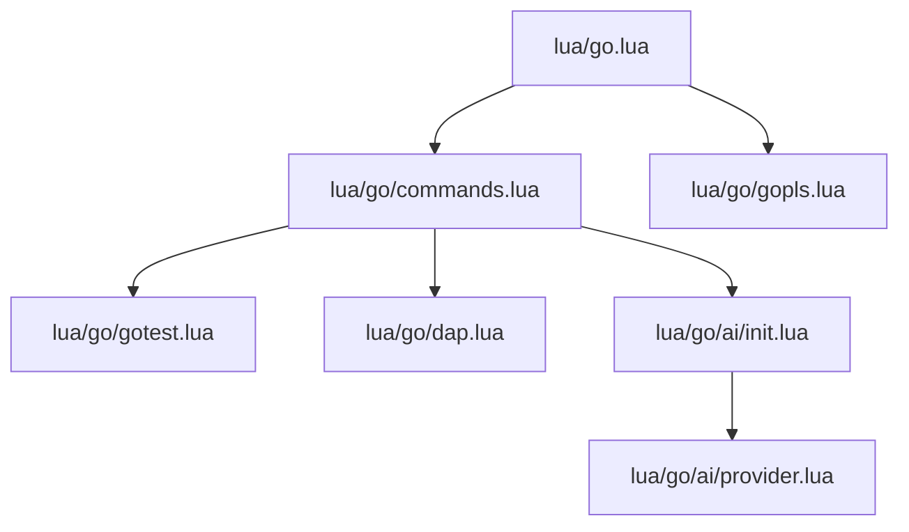

# ray-x/go.nvim

> Neovim plugin for Go development: gopls, tests, debugging, code generation and AI commands.

## The problem
Doing Go in Neovim requires assembling gopls, tests, linters, a debugger and generators.

## What it actually does
`lua/go.lua` registers the commands from `commands.lua`, which call modules: tests, formatting, `iferr`, debugging with nvim-dap, gopls. The AI commands (`GoAI`, `GoCodeReview`, `GoAIChat`) go through a Copilot or OpenAI provider, or an MCP client.

## How it is wired


## Trying it
```lua
require('go').setup()
require('go').setup({ ai = { enable = true, provider = 'copilot' } })
```

## Cost and gotchas
Free. Neovim 0.12 for the main branch (0.11: version v0.11). The AI functions assume a Copilot or OpenAI account at your expense.

## What it is not
Not a full IDE: it is a Neovim plugin that adds to your editor. Not useful outside Go: everything it brings targets that language.

## Alternatives
No alternative named in the README.

## For you
Ignore: relevant only if you write Go in Neovim, which is rare in data / AI.
