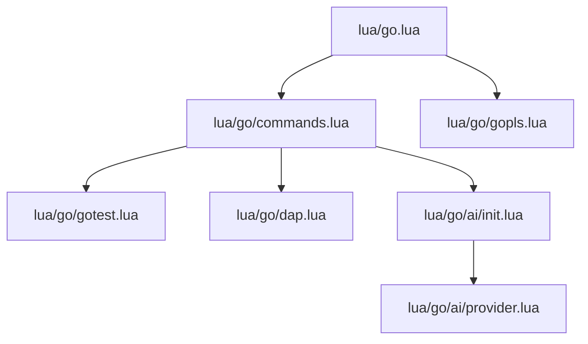

# ray-x/go.nvim

> Plugin Neovim pour développer en Go : gopls, tests, débogage, génération de code et commandes IA.

## Le problème
Faire du Go dans Neovim demande d'assembler gopls, tests, linters, débogueur et générateurs.

## Ce que ça fait vraiment
`lua/go.lua` enregistre les commandes de `commands.lua`, qui appellent des modules : tests, formatage, `iferr`, débogage avec nvim-dap, gopls. Les commandes IA (`GoAI`, `GoCodeReview`, `GoAIChat`) passent par un fournisseur Copilot ou OpenAI, ou un client MCP.

## Comment c'est branché


## Essayer
```lua
require('go').setup()
require('go').setup({ ai = { enable = true, provider = 'copilot' } })
```

## Coût et pièges
Gratuit. Neovim 0.12 pour la branche principale (0.11 : version v0.11). Les fonctions IA supposent un compte Copilot ou OpenAI à ta charge.

## Ce que ce n'est pas
Pas un IDE complet : c'est un plugin Neovim qui s'ajoute à ton éditeur. Pas utile hors Go : tout ce qu'il apporte vise ce langage.

## Alternatives
Aucune alternative nommée dans le README.

## Pour toi
Ignorer : pertinent seulement si tu écris du Go dans Neovim, ce qui est rare en data / IA.

