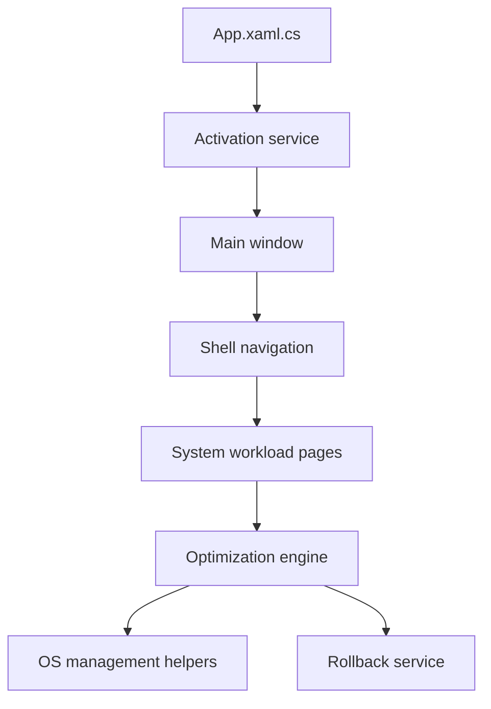

# rayenghanmi/RyTuneX

> Windows 10 and 11 app to tune performance, privacy and services, and remove the superfluous.

## The problem
Windows ships with preinstalled apps, telemetry and hidden settings that are hard to change by hand.

## What it actually does
WinUI 3 application in C# on .NET 10 that applies tweaks (latency, memory, network, TCP/IP), debloats apps, cleans 12 caches, hardens privacy (telemetry, Recall, Copilot), and manages startup, services, processes, policies and WinGet packages. Optimization engine with per-tweak undo and a "Revert All Changes" option.

## How it is wired


## Trying it
```bash
winget install --id 9PDH8M7HF2SQ
```

## Cost and gotchas
Free. The README recommends creating a restore point before any deep tweak. Installation through the Microsoft Store only, no more packages outside the Store.

## What it is not
Not cross-platform: Windows only (the Android version is a separate project). Low-level tweaks carry a risk, flagged by badges.

## Alternatives
No alternative named in the README.

## For you
Ignore: a Windows workstation tuning utility, unrelated to data, AI or MLOps work.
