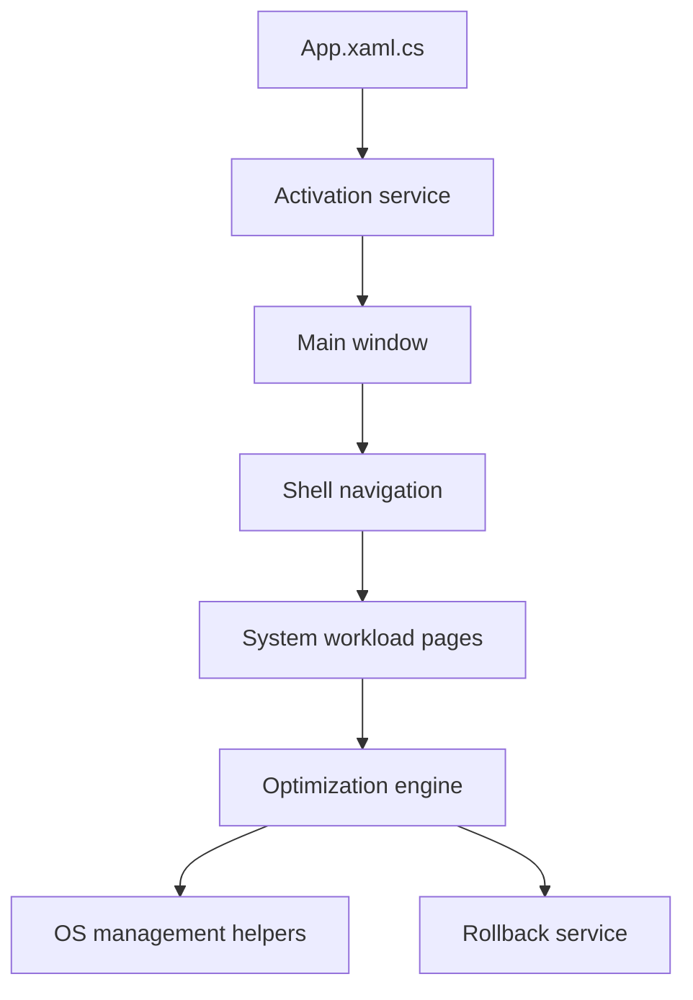

# rayenghanmi/RyTuneX

> Application Windows 10 et 11 pour régler performances, vie privée et services, et retirer le superflu.

## Le problème
Windows embarque des applications préinstallées, de la télémétrie et des réglages cachés difficiles à modifier à la main.

## Ce que ça fait vraiment
Application WinUI 3 en C# sur .NET 10 qui applique des réglages (latence, mémoire, réseau, TCP/IP), débloate des applications, nettoie 12 caches, durcit la vie privée (télémétrie, Recall, Copilot), gère démarrage, services, processus, stratégies et paquets WinGet. Moteur d'optimisation avec annulation par réglage et option « Revert All Changes ».

## Comment c'est branché


## Essayer
```bash
winget install --id 9PDH8M7HF2SQ
```

## Coût et pièges
Gratuit. Le README recommande de créer un point de restauration avant tout réglage profond. Installation via Microsoft Store uniquement, plus de paquets hors Store.

## Ce que ce n'est pas
Pas multiplateforme : Windows seulement (la version Android est un projet séparé). Les réglages bas niveau comportent un risque, signalé par des badges.

## Alternatives
Aucune alternative nommée dans le README.

## Pour toi
À ignorer : utilitaire de réglage de poste Windows, sans lien avec un travail data, IA ou MLOps.

