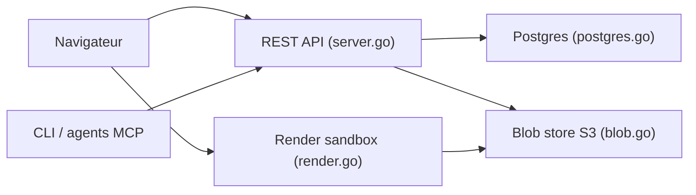

# razorpay/slashdocs

> Self-hosted workspace where agents and humans publish, comment on and version HTML documents.

## The problem
Agents produce long reports pasted into a chat, hard to review, comment on and version as a team.

## What it actually does
- One document = one standalone HTML file, immutable versions, comments anchored to the text, resolve/reopen, sharing.
- Web review interface (rendered in a sandboxed iframe on a separate domain), Go CLI and remote MCP endpoint with OAuth.
- OIDC authentication (Google, Okta, Entra ID, Keycloak, Dex) and service accounts for agents; Slack notifications.
- A single Go binary; it requires Postgres and S3-compatible storage.

## How it is wired


## Trying it
```bash
git clone https://github.com/razorpay/slashdocs.git
cd slashdocs
docker compose up
slashdocs auth login localhost:8080
slashdocs docs create report.html --title "Agent report"
slashdocs docs comments list doc_123
```
Demo login: `admin@example.com` / `password` (Dex, development use only).

## Cost and gotchas
Free, but you host Postgres, S3 and an OIDC provider; two distinct hostnames are required for isolation. No telemetry according to the README. 49 open issues; project from June 2026.

## What it is not
Not a wiki nor a real-time collaborative editor: agents publish HTML, humans comment. Uploaded HTML is treated as untrusted.

## Alternatives
No alternative named in the README.

## For you
Watch: relevant for sharing an MLOps team's agent reports, but young and heavy to deploy.
