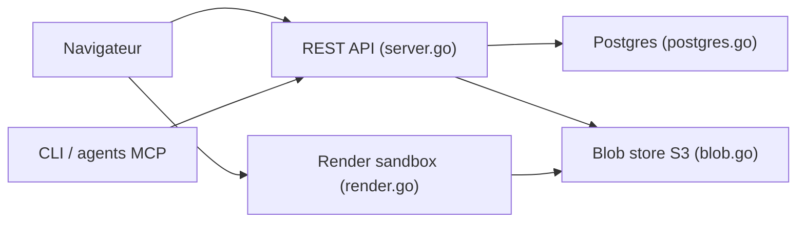

# razorpay/slashdocs

> Espace de travail auto-hébergé où agents et humains publient, commentent et versionnent des documents HTML.

## Le problème
Les agents produisent de longs rapports collés dans un chat, difficiles à relire, commenter et versionner en équipe.

## Ce que ça fait vraiment
- Un document = un fichier HTML autonome, versions immuables, commentaires ancrés sur le texte, résolution/réouverture, partage.
- Interface web de revue (rendu en iframe sandboxée sur un domaine distinct), CLI Go et endpoint MCP distant avec OAuth.
- Authentification OIDC (Google, Okta, Entra ID, Keycloak, Dex) et comptes de service pour agents ; notifications Slack.
- Un binaire Go unique ; il faut Postgres et un stockage compatible S3.

## Comment c'est branché


## Essayer
```bash
git clone https://github.com/razorpay/slashdocs.git
cd slashdocs
docker compose up
slashdocs auth login localhost:8080
slashdocs docs create report.html --title "Agent report"
slashdocs docs comments list doc_123
```
Connexion de démo : `admin@example.com` / `password` (Dex, usage développement uniquement).

## Coût et pièges
Gratuit, mais tu héberges Postgres, S3 et un fournisseur OIDC ; deux noms d'hôte distincts requis pour l'isolation. Aucune télémétrie selon le README. 49 issues ouvertes ; projet de juin 2026.

## Ce que ce n'est pas
Pas un wiki ni un éditeur collaboratif en temps réel : les agents publient des HTML, les humains commentent. Le HTML téléversé est traité comme non fiable.

## Alternatives
Aucune alternative nommée dans le README.

## Pour toi
À surveiller : pertinent pour partager les rapports d'agents d'une équipe MLOps, mais jeune et lourd à déployer.

