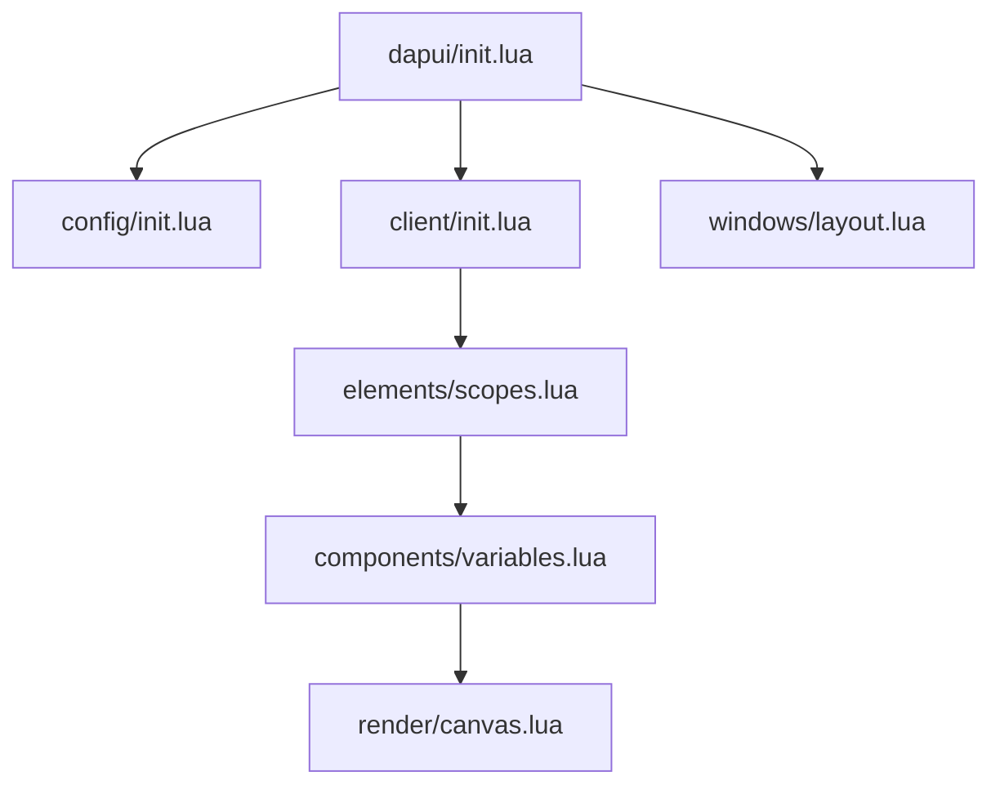

# rcarriga/nvim-dap-ui

> Debugging interface for nvim-dap, with panels for variables, stacks, watches and breakpoints.

## The problem
Debugging in Neovim with nvim-dap alone gives no clear view of variables, threads or breakpoints.

## What it actually does
Provides "elements" (scopes, stacks, watches, breakpoints, REPL, console), arranged in layouts on the sides of the screen or in floating windows. Automatic opening and closing via nvim-dap events; evaluation of an expression on hover.

## How it is wired


## Trying it
```lua
{ "rcarriga/nvim-dap-ui", dependencies = {"mfussenegger/nvim-dap", "nvim-neotest/nvim-nio"} }
require("dapui").setup()
require("dapui").toggle()
```

## Cost and gotchas
Free. Requires Neovim, nvim-dap and nvim-nio; icons need a codicons font.

## What it is not
Not a debugger: it only displays what nvim-dap and the adapters provide. Useless outside Neovim.

## Alternatives
No alternative cited in the README.

## For you
Watch: useful if you code your Python pipelines in Neovim, pointless otherwise.
