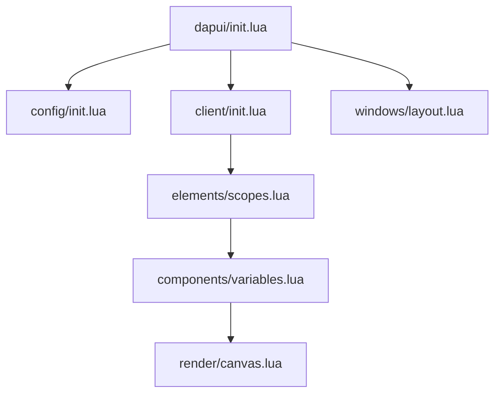

# rcarriga/nvim-dap-ui

> Interface de débogage pour nvim-dap, avec panneaux de variables, piles, watches et points d'arrêt.

## Le problème
Déboguer dans Neovim avec nvim-dap seul n'offre pas de vue claire des variables, des threads ni des points d'arrêt.

## Ce que ça fait vraiment
Fournit des « éléments » (scopes, stacks, watches, breakpoints, REPL, console), rangés en dispositions sur les côtés de l'écran ou en fenêtres flottantes. Ouverture et fermeture automatiques via les événements de nvim-dap ; évaluation d'une expression au survol.

## Comment c'est branché


## Essayer
```lua
{ "rcarriga/nvim-dap-ui", dependencies = {"mfussenegger/nvim-dap", "nvim-neotest/nvim-nio"} }
require("dapui").setup()
require("dapui").toggle()
```

## Coût et pièges
Gratuit. Exige Neovim, nvim-dap et nvim-nio ; les icônes demandent une police codicons.

## Ce que ce n'est pas
Pas un débogueur : il n'affiche que ce que nvim-dap et les adaptateurs fournissent. Ne sert pas hors Neovim.

## Alternatives
Aucune alternative citée dans le README.

## Pour toi
Surveiller : utile si tu codes tes pipelines Python sous Neovim, sans intérêt sinon.

