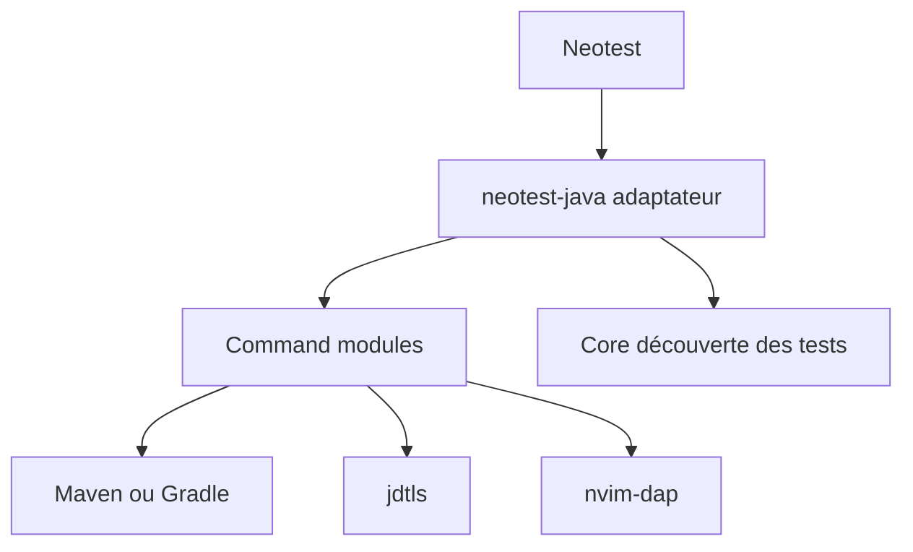

# rcasia/neotest-java

> Neotest adapter for Neovim that runs and debugs Java JUnit tests, with Maven or Gradle.

## The problem
Running JUnit tests from Neovim requires building the command line and the classpath by hand.

## What it actually does
Detects JUnit 5 tests, supports Maven and Gradle, multi-module projects and Spring. It fetches the classpath from the jdtls language server, downloads the JUnit Console JAR with SHA-256 verification, and debugs with nvim-dap. An injection API makes it possible to replace the LSP client or the classpath resolution.

## How it is wired


## Trying it
```vim
:TSInstall java
:NeotestJava setup
```
```bash
lx install neotest-java
```

## Cost and gotchas
Neovim 0.10.4 minimum, nvim-treesitter, and a jdtls server through nvim-jdtls or nvim-java. For a multi-module project, remove pom.xml and build.gradle from jdtls's root_dir markers. Java and the JDK are not in the list of prerequisites.

## What it is not
Not a universal test runner: a Java and JUnit adapter only.

## Alternatives
- No alternative named in the README.

## For you
Ignore: useful only if you test Java in Neovim.
