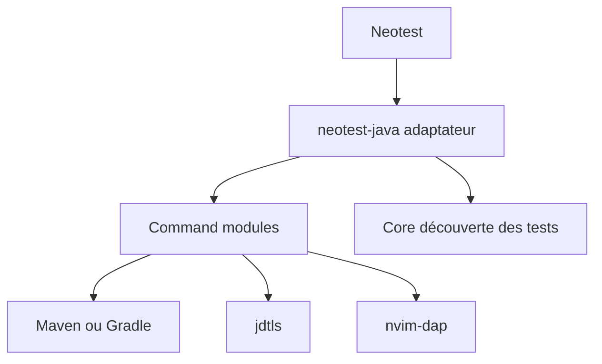

# rcasia/neotest-java

> Adaptateur Neotest pour Neovim qui lance et débogue des tests Java JUnit, avec Maven ou Gradle.

## Le problème
Exécuter des tests JUnit depuis Neovim demande de construire à la main la ligne de commande et le classpath.

## Ce que ça fait vraiment
Détecte les tests JUnit 5, supporte Maven et Gradle, les projets multi-modules et Spring. Il récupère le classpath depuis le serveur de langage jdtls, télécharge le JAR JUnit Console avec vérification SHA-256, et débogue avec nvim-dap. Une API d'injection permet de remplacer le client LSP ou la résolution du classpath.

## Comment c'est branché


## Essayer
```vim
:TSInstall java
:NeotestJava setup
```
```bash
lx install neotest-java
```

## Coût et pièges
Neovim 0.10.4 minimum, nvim-treesitter, et un serveur jdtls via nvim-jdtls ou nvim-java. Pour un projet multi-module, retirer pom.xml et build.gradle des marqueurs root_dir de jdtls. Java et JDK ne figurent pas dans la liste des prérequis.

## Ce que ce n'est pas
Pas un lanceur de tests universel : un adaptateur Java et JUnit seulement.

## Alternatives
- Aucune alternative nommée dans le README.

## Pour toi
Ignorer : utile uniquement si tu testes du Java dans Neovim.

