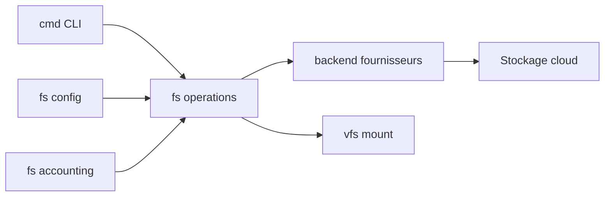

# rclone/rclone

> "rsync for cloud storage": synchronizes and copies files between disks and dozens of services.

## The problem
Moving or synchronizing datasets between different cloud and local storages requires one tool per provider.

## What it actually does
A single command that copies, synchronizes (one-way or bidirectional), verifies MD5/SHA-1 hashes, mounts storage via FUSE and serves files over HTTP, WebDAV, FTP, SFTP or DLNA. More than a hundred providers (S3, GCS, Azure, Drive, SFTP...) plus virtual layers: encryption (Crypt), compression, splitting (Chunker), union.

## How it is wired

## Trying it
No command documented in this README: installation and configuration are referred to the rclone.org website.

## Cost and gotchas
Free; provider storage and traffic remain at your expense, and an account or credentials per service are required. The Cache backend is marked deprecated.

## What it is not
Not a turnkey backup service: you must schedule and monitor the synchronizations.

## Alternatives
No alternative named in the README.

## For you
Adopt: common tool for moving datasets and artifacts between object stores.
