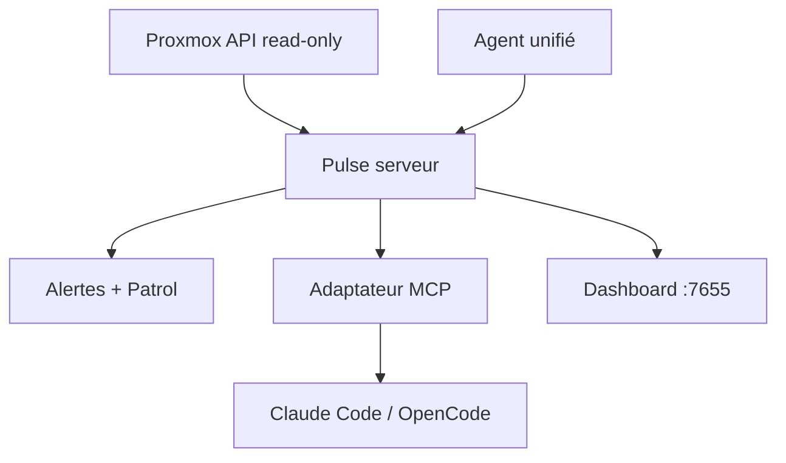

# rcourtman/Pulse

> Self-hosted monitoring workspace for Proxmox, Docker, Kubernetes, TrueNAS and machines.

## The problem
Monitoring a multi-platform homelab (Proxmox, Docker, K8s, TrueNAS, VMs) without a heavy enterprise monitoring stack. Dashboards do not see problems when nobody is looking.

## What it actually does
Live state, history, alerts, recovery visibility and scheduled checks. "Pulse Patrol" makes rounds and detects failed backups, capacity pressure, restart loops, clock drift. Each platform has its own view, on a shared resource model. Credentials encrypted at rest, scoped tokens, agent commands disabled by default. Interactive assistant and MCP adapter (Claude Code, OpenCode).

## How it is wired


## Trying it
```bash
docker run -d --name pulse -p 7655:7655 -v pulse_data:/data \
  -e PULSE_DEPLOYMENT_METHOD=docker_run --restart unless-stopped rcourtman/pulse:vX.Y.Z
```

## Cost and gotchas
The Community edition is free (7 days of history); the Relay/Pro/MSP editions are paid and add remote access, investigation, RBAC, audit. Signed installer (SSH verification). vSphere in early access. Does not accept unsolicited PRs.

## What it is not
Not an observability platform like Prometheus/Grafana: geared toward infrastructure state and rounds. Advanced features are paid.

## Alternatives
Not named in the README.

## For you
For your homelab if you run Proxmox/Docker/K8s; the MCP adapter is a plus. Not much related to data/AI in itself.
