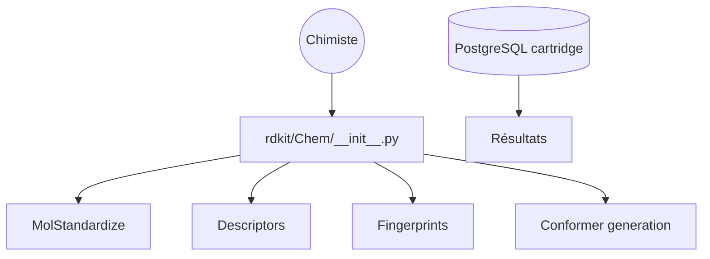

# rdkit/rdkit

> Cheminformatics and machine learning toolkit in C++ and Python, for chemists and data scientists.

## The problem
Processing molecules (structures, descriptors, similarity search) without a dedicated library is a project in itself.

## What it actually does
- 2D and 3D molecular operations, reactions, conformers and force fields.
- Descriptors and fingerprints for machine learning.
- C++ core, Python interface, Java, C#, JavaScript bindings.
- PostgreSQL cartridge for substructure and similarity search, KNIME nodes.

## How it is wired


## Trying it
```bash
conda install -c conda-forge rdkit
```

## Cost and gotchas
Free, BSD. Installation via conda is recommended. Installation details are in Docs/Book/Install.md.

## What it is not
Not a graphical application nor a ready-to-use model: a library you program against. Several internal links were not read in the code.

## Alternatives
No alternative named in the README.

## For you
Adopt for any AI project on molecules: descriptors and fingerprints feed directly into your models, under a BSD license.
