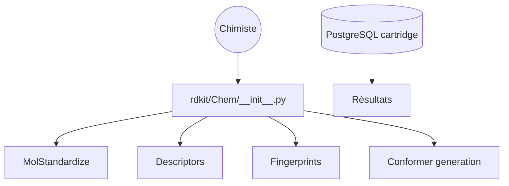

# rdkit/rdkit

> Boîte à outils de chémoinformatique et d'apprentissage automatique en C++ et Python, pour chimistes et data scientists.

## Le problème
Traiter des molécules (structures, descripteurs, recherche de similarité) sans bibliothèque dédiée est un chantier à part entière.

## Ce que ça fait vraiment
- Opérations moléculaires 2D et 3D, réactions, conformères et champs de force.
- Descripteurs et empreintes (fingerprints) pour l'apprentissage automatique.
- Cœur C++, interface Python, liaisons Java, C#, JavaScript.
- Cartouche PostgreSQL pour recherche par sous-structure et similarité, nœuds KNIME.

## Comment c'est branché


## Essayer
```bash
conda install -c conda-forge rdkit
```

## Coût et pièges
Gratuit, BSD. Installation recommandée par conda. Le détail d'installation est dans Docs/Book/Install.md.

## Ce que ce n'est pas
Pas une application graphique ni un modèle prêt à l'emploi : une bibliothèque que tu programmes. Plusieurs liens internes n'ont pas été lus dans le code.

## Alternatives
Aucune alternative nommée dans le README.

## Pour toi
À adopter pour tout projet IA sur molécules : descripteurs et empreintes alimentent directement tes modèles, sous licence BSD.

