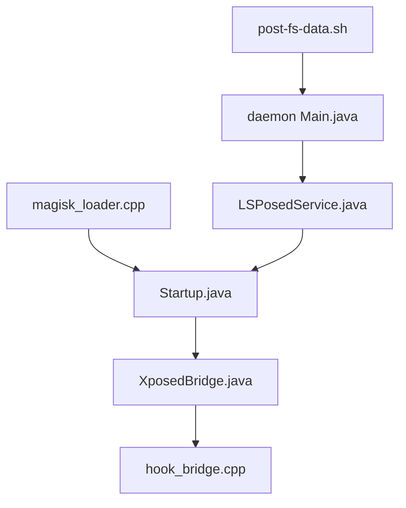

# re-zero001/LSPosed-Irena

> Zygisk module providing an Xposed-compatible ART hooking framework, for rooted Android.

## The problem
Changing the behavior of the Android system or of apps without touching the APKs requires a hooking framework consistent with Xposed.

## What it actually does
A Magisk module launches a daemon, and a Zygisk loader injects the core into every process; XposedBridge relies on native code to hook ART methods. A manager app handles modules and scopes. Fork of LSPosed, based on LSPlant.

## How it is wired

## Trying it
Installation is described without a code block: Magisk v26+, ZygiskNext, install LSPosed in Magisk, reboot, open the manager. Download via Telegram @lsposed-irena.

## Cost and gotchas
Free. Requires a rooted Android (Magisk). Only bug reports on the latest debug version are accepted.

## What it is not
Not a tool to install on a non-rooted phone. Not related to data / AI work.

## Alternatives
LSPosed and EdXposed, cited as the sources of the fork.

## For you
Ignore: it is for customizing rooted Android, with no link to data / AI / MLOps work.
