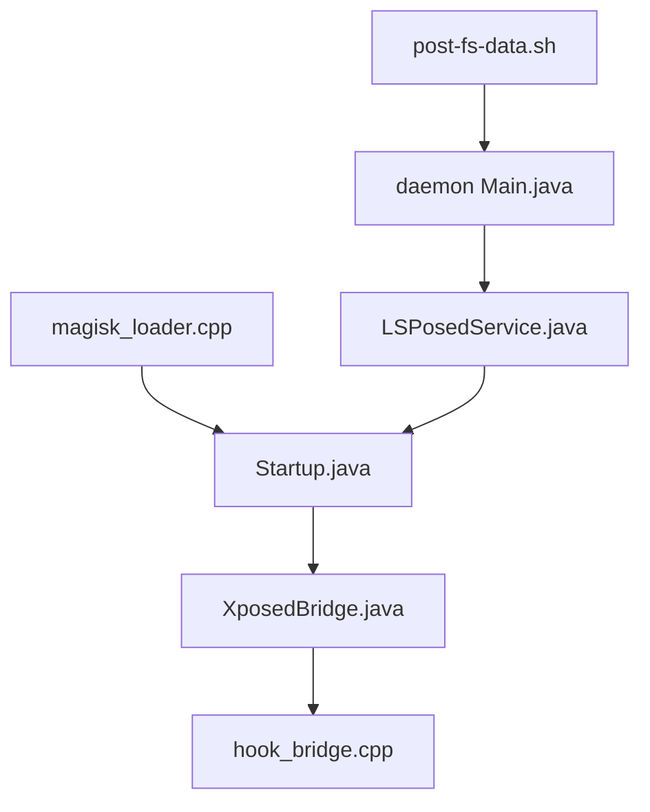

# re-zero001/LSPosed-Irena

> Module Zygisk qui fournit un cadre de hooking ART compatible Xposed, pour Android rooté.

## Le problème
Modifier le comportement du système ou d'applications Android sans toucher aux APK demande un cadre de hooks cohérent avec Xposed.

## Ce que ça fait vraiment
Un module Magisk lance un démon, un chargeur Zygisk injecte le cœur dans chaque processus ; XposedBridge s'appuie sur du code natif pour accrocher les méthodes ART. Une application manager gère modules et portées. Fork de LSPosed, basé sur LSPlant.

## Comment c'est branché

## Essayer
Installation décrite sans bloc de code : Magisk v26+, ZygiskNext, installer LSPosed dans Magisk, redémarrer, ouvrir le manager. Téléchargement via Telegram @lsposed-irena.

## Coût et pièges
Gratuit. Exige un Android rooté (Magisk). Seuls les rapports de bug sur la dernière version de debug sont acceptés.

## Ce que ce n'est pas
Pas un outil à installer sur un téléphone non rooté. Pas lié au travail data / IA.

## Alternatives
LSPosed et EdXposed, cités comme sources du fork.

## Pour toi
Ignorer : sert à personnaliser Android rooté, sans lien avec un travail data / IA / MLOps.

