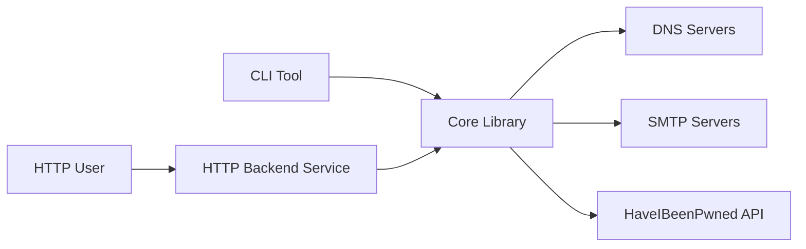

# reacherhq/check-if-email-exists

> Checks whether an email address exists without sending a message, in Rust, with an HTTP backend.

## The problem
Invalid addresses degrade mailings and contact databases; verification services are paid.

## What it actually does
Rust library, CLI and HTTP backend: syntax validation, MX records, SMTP connection, deliverability, disabled or full inbox, "catch-all" address, disposable email, role account, Gravatar, Have I Been Pwned. Returns a JSON with an `is_reachable` field.

## How it is wired


## Trying it
```bash
docker run -p 8080:8080 reacherhq/backend:latest
cargo add check-if-email-exists
```

## Cost and gotchas
Outgoing port 25 must be open. Beyond small volumes, SMTP proxies are needed (a third-party service is recommended). A paid SaaS offer is provided alongside.

## What it is not
Not 100% reliable: some servers block verification. "Honeypot" and free-provider detections are only planned.

## Alternatives
hunter.io, verify-email.org and email-checker.net are cited as paid services that this tool replaces.

## For you
Worth watching: useful for cleaning contact datasets, with the constraint of port 25 and proxies.
