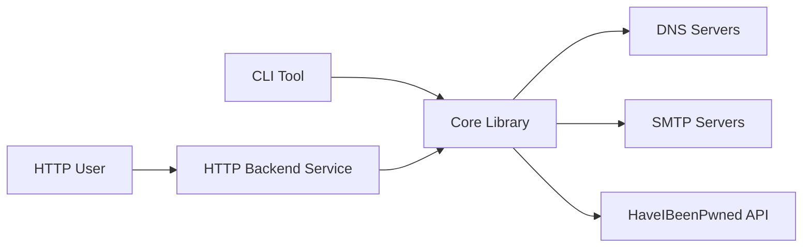

# reacherhq/check-if-email-exists

> Vérifie si une adresse e-mail existe sans envoyer de message, en Rust, avec backend HTTP.

## Le problème
Des adresses invalides dégradent les envois et les bases de contacts ; les services de vérification sont payants.

## Ce que ça fait vraiment
Bibliothèque Rust, CLI et backend HTTP : validation de syntaxe, enregistrements MX, connexion SMTP, délivrabilité, boîte désactivée ou pleine, adresse « catch-all », e-mail jetable, compte de rôle, Gravatar, Have I Been Pwned. Renvoie un JSON avec un champ `is_reachable`.

## Comment c'est branché


## Essayer
```bash
docker run -p 8080:8080 reacherhq/backend:latest
cargo add check-if-email-exists
```

## Coût et pièges
Le port 25 sortant doit être ouvert. Au-delà de petits volumes, des proxys SMTP sont nécessaires (service tiers recommandé). Une offre SaaS payante est proposée en parallèle.

## Ce que ce n'est pas
Pas fiable à 100 % : certains serveurs bloquent la vérification. Les détections « honeypot » et fournisseur gratuit sont seulement prévues.

## Alternatives
hunter.io, verify-email.org et email-checker.net sont cités comme services payants que cet outil remplace.

## Pour toi
À surveiller : utile pour nettoyer des jeux de données de contacts, avec la contrainte du port 25 et des proxys.

