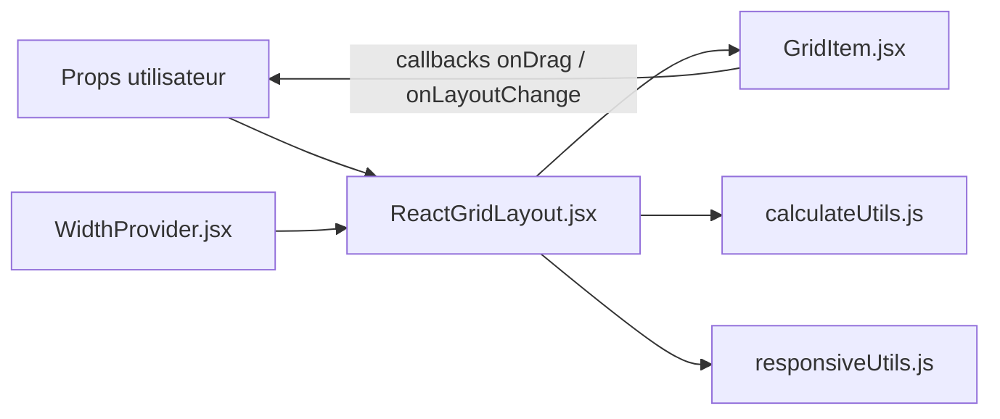

# react-grid-layout/react-grid-layout

> Grid of draggable and resizable widgets for React, useful for building dashboards.

## The problem
A dashboard where the user rearranges their widgets requires placement calculation, compaction and responsive breakpoints, which are painful to code yourself.

## What it actually does
`ReactGridLayout` and `Responsive` components, plus hooks (`useContainerWidth`, `useGridLayout`, `useResponsiveLayout`). The layout is described by `{i, x, y, w, h}` items, and can be serialized and restored. v2 is a TypeScript rewrite with pluggable compactors and a fast mode for 200+ widgets. A `legacy` layer keeps the v1 API. The README cites Grafana, Metabase and Kibana among its users.

## How it is wired


## Trying it
```bash
npm install react-grid-layout
```
Then import the stylesheets `react-grid-layout/css/styles.css` and `react-resizable/css/styles.css`.

## Cost and gotchas
Free. v2 requires React 18+; the `width` prop is mandatory (hence `useContainerWidth`). React 16/17 stay on 0.17.

## What it is not
Not a visualization tool: it places blocks, it draws no charts. Migrating from v1 to v2 requires a change of import or props.

## Alternatives
No alternative cited in the README (Packery and Gridster are mentioned as points of comparison, without jQuery here).

## For you
Adopt it if you are building a React dashboard to track models or metrics: it is the proven building block behind several well-known data tools.
