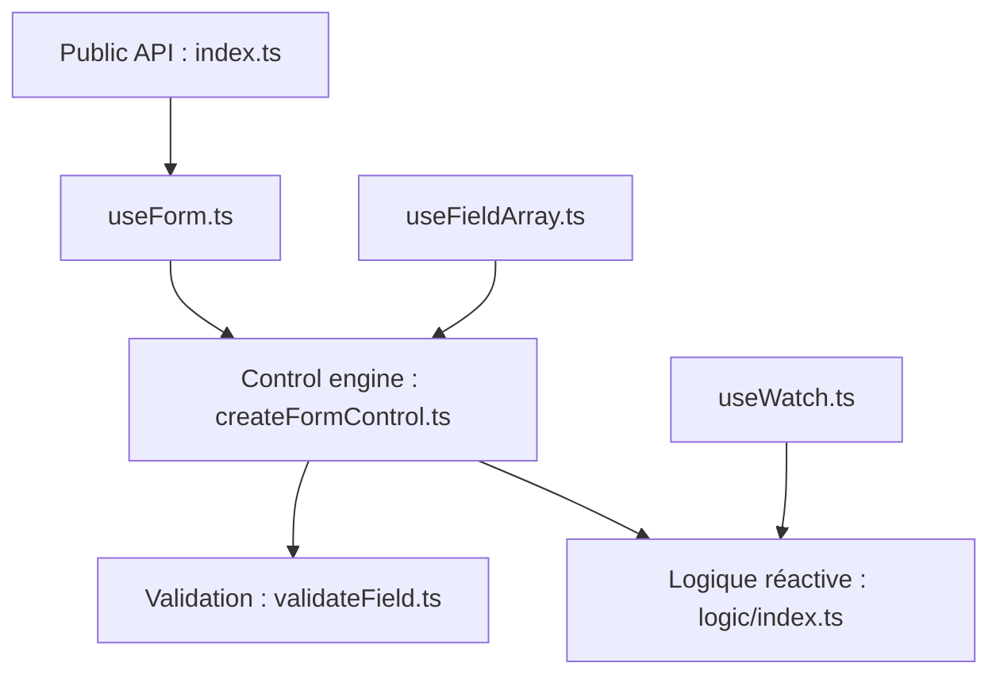

# react-hook-form/react-hook-form

> React hooks library for managing state, validation and field registration in forms.

## The problem
Controlled React forms cause many re-renders and a lot of repetitive validation code.

## What it actually does
`useForm` registers fields with `register` and handles submission, reset and validation. `useController` adapts controlled components, `useFieldArray` handles dynamic lists, `useWatch` and `useFormState` subscribe to state. Validation is native HTML or goes through resolvers (Yup, Zod, AJV, Superstruct, Joi).

## How it is wired


## Trying it
```bash
npm install react-hook-form
```
```jsx
import { useForm } from 'react-hook-form';
const { register, handleSubmit, formState: { errors } } = useForm();
```

## Cost and gotchas
Free, no declared dependencies. React only: you need an existing React application.

## What it is not
Not a UI component: it manages state, not display. Not a server-side or non-React forms tool.

## Alternatives
No alternative named in the README.

## For you
Ignore for a data / AI / MLOps profile, unless you are building a React front end for an internal tool: the library only serves web forms.
