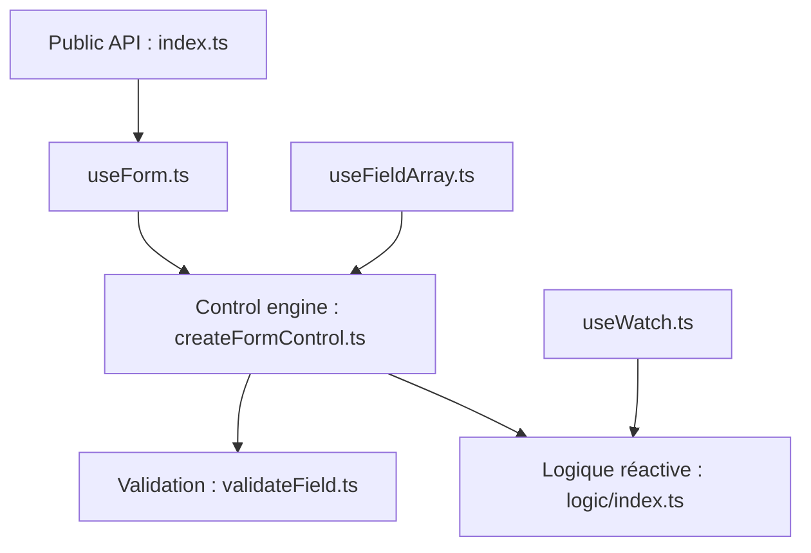

# react-hook-form/react-hook-form

> Bibliothèque de hooks React pour gérer l'état, la validation et l'enregistrement des champs de formulaires.

## Le problème
Les formulaires React contrôlés provoquent beaucoup de rendus et de code répétitif pour la validation.

## Ce que ça fait vraiment
`useForm` enregistre les champs avec `register` et gère soumission, reset et validation. `useController` adapte les composants contrôlés, `useFieldArray` les listes dynamiques, `useWatch` et `useFormState` s'abonnent à l'état. La validation est native HTML ou passe par des résolveurs (Yup, Zod, AJV, Superstruct, Joi).

## Comment c'est branché


## Essayer
```bash
npm install react-hook-form
```
```jsx
import { useForm } from 'react-hook-form';
const { register, handleSubmit, formState: { errors } } = useForm();
```

## Coût et pièges
Gratuit, sans dépendance annoncée. Réservé à React : il faut une application React existante.

## Ce que ce n'est pas
Pas un composant d'interface : il gère l'état, pas l'affichage. Pas un outil de formulaires côté serveur ou hors React.

## Alternatives
Aucune alternative nommée dans le README.

## Pour toi
À ignorer pour un profil data / IA / MLOps, sauf si tu construis un front React pour un outil interne : la bibliothèque ne sert qu'aux formulaires web.

