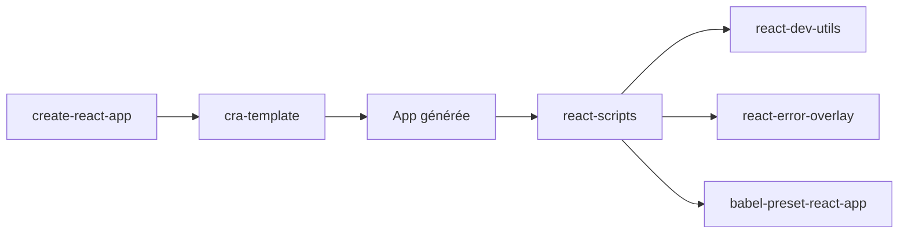

# react/create-react-app

> A single-page React project generator with a preconfigured build, for developers new to React.

## The problem
Configuring webpack, Babel and ESLint to start a React application is slow and fragile.

## What it actually does
The command creates a folder with `public/`, `src/` and a single dependency, `react-scripts`, which provides `start` (dev server, hot reload), `test` (Jest), `build` (minified, hashed bundle) and `eject` (leaving the hidden config). Around it: JS and TypeScript templates, `react-dev-utils`, an error overlay, a Babel preset, an ESLint config, polyfills.

## How it is wired


## Trying it
```bash
npx create-react-app my-app
cd my-app
npm start
npm run build
```

## Cost and gotchas
Free. Node 14.0.0 or later required locally. Last push in February 2025, over 2,400 open issues. The same figures and the same README exist in facebook/create-react-app, probable duplicate not verified.

## What it is not
Not a tool for server rendering, a static site or a Rails/Django integration: the README points elsewhere for those cases. Once ejected, the config becomes your responsibility.

## Alternatives
- Next.js: server rendering and pre-rendering.
- Gatsby: mostly static sites, pre-rendered at build time.
- Neutrino: deeper customization of the build chain.

## For you
Ignore: a front-end generator with a last commit over a year old, unrelated to data/AI work.
