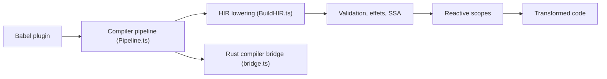

# react/react

> JavaScript library for building user interfaces from components, with a memoisation compiler.

## The problem
Updating a user interface by hand when state changes quickly leads to code that is hard to reason about. You want to declare the interface as a function of state.

## What it actually does
README identical to that of facebook/react: components, client, server and native rendering. The architecture graph here emphasises the React compiler: a Babel plugin calls `Pipeline.ts`, which lowers the code into HIR (`BuildHIR.ts`), infers effects, validates, optimises, rewrites to SSA, forms reactive scopes and then generates the code. A bridge to a Rust compiler (`bridge.ts`) and a playground appear in the tree. The README is truncated in the same way (it starts at "Installation").

## How it is wired


## Trying it
```bash
# Aucune commande documentée dans le README fourni.
```

## Cost and gotchas
Free. This repository appears to be the same project as facebook/react (identical README; different star counts and push dates, a probable sign of a rename), a point not verified. Do not count it twice when sorting.

## What it is not
Not a second library: nothing in the README establishes a difference from facebook/react. The rendering engines (DOM, native) are not detailed in the graph.

## Alternatives
No alternative named in the README.

## For you
Ignore: apparent duplicate of facebook/react, and outside the data/AI/MLOps scope; keep the facebook/react entry if you want a trace.
