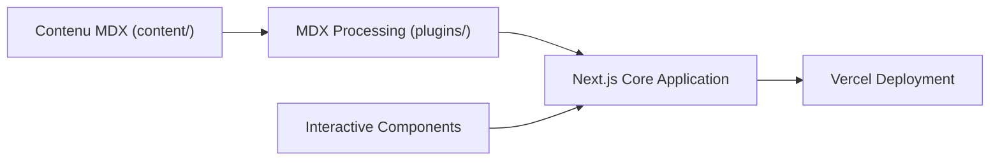

# reactjs/react.dev

> Source code and content of the official React documentation site, for contributors.

## The problem
Contributing to the React documentation requires knowing how the site is built and tested.

## What it actually does
The repository contains a Next.js site whose content is in Markdown/MDX, with interactive examples (Sandpack) and remark plugins. The README mostly describes the contribution flow: fork, branch, `yarn dev`, `yarn check-all`, pull request.

## How it is wired


## Trying it
```bash
yarn
yarn dev
yarn check-all
```

## Cost and gotchas
Free. Node 16.8 or later and Yarn required. Content under the CC-BY-4.0 license. 1,638 open issues.

## What it is not
Not the React library itself: it is the site of its documentation.

## Alternatives
No alternative named in the README.

## For you
Ignore, except to contribute to the React docs: it is not a data/AI tool.
