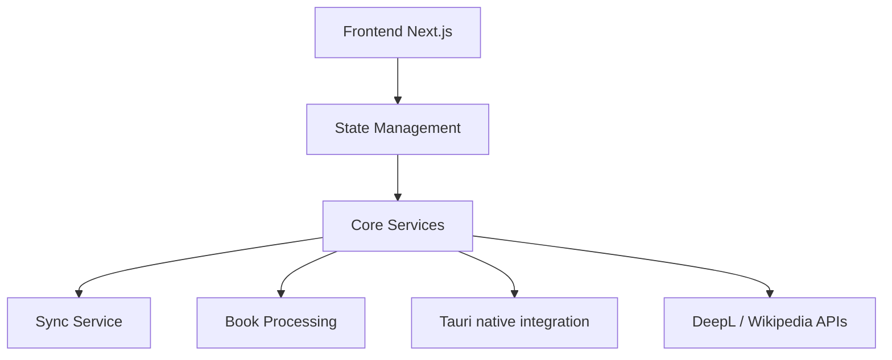

# readest/readest

> Cross-platform open source ebook reader (Next.js and Tauri) with annotations, sync and read-aloud.

## The problem
Reading EPUB, PDF, MOBI and others on all your devices with synchronized annotations and progress.

## What it actually does
Formats EPUB, PDF, MOBI, FB2, CBZ, etc.; full-text search, highlighting, dictionaries, DeepL translation, text-to-speech, synchronized reading, OPDS/Calibre, sync with Koreader. Available on macOS, Windows, Linux, Android, iOS and Web.

## How it is wired


## Trying it
```bash
nix run --accept-flake-config github:readest/readest
flatpak run com.bilingify.readest
```
Other installation methods: App Store, website, GitHub releases, Flathub.

## Cost and gotchas
Free. On Windows, WebView2 is required. On Wayland, XWayland is needed. AGPL-3.0 license: obligations if you redistribute.

## What it is not
Not a data/AI tool: a reading application. AI summarization is only planned.

## Alternatives
- Foliate: of which Readest is a rewrite.
- Koreader: can be synchronized with Readest.

## For you
Ignore for your data/MLOps work: consumer application with no connection to your field.
