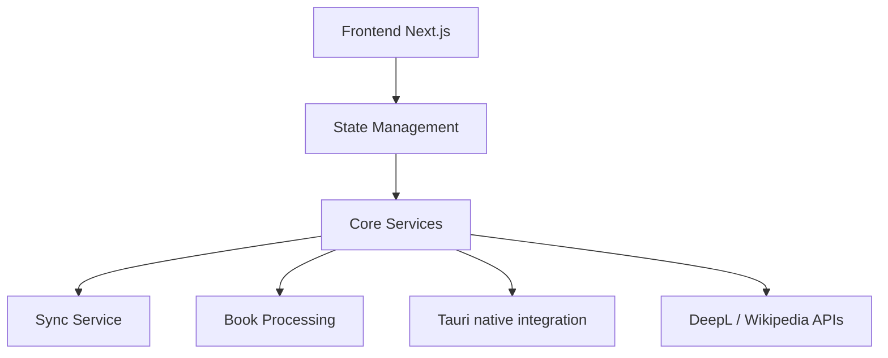

# readest/readest

> Lecteur d'ebooks open source multiplateforme (Next.js et Tauri) avec annotations, synchro et lecture à voix haute.

## Le problème
Lire EPUB, PDF, MOBI et autres sur tous ses appareils avec annotations et progression synchronisées.

## Ce que ça fait vraiment
Formats EPUB, PDF, MOBI, FB2, CBZ, etc. ; recherche plein texte, surlignage, dictionnaires, traduction DeepL, synthèse vocale, lecture synchronisée, OPDS/Calibre, synchro avec Koreader. Disponible sur macOS, Windows, Linux, Android, iOS et Web.

## Comment c'est branché


## Essayer
```bash
nix run --accept-flake-config github:readest/readest
flatpak run com.bilingify.readest
```
Autres installations : App Store, site web, releases GitHub, Flathub.

## Coût et pièges
Gratuit. Sous Windows, WebView2 requis. Sous Wayland, XWayland nécessaire. Licence AGPL-3.0 : obligations en cas de redistribution.

## Ce que ce n'est pas
Pas un outil de data/IA : une application de lecture. Le résumé IA est seulement planifié.

## Alternatives
- Foliate : dont Readest est une réécriture.
- Koreader : synchronisable avec Readest.

## Pour toi
À ignorer pour ton travail data/MLOps : application grand public sans lien métier.

