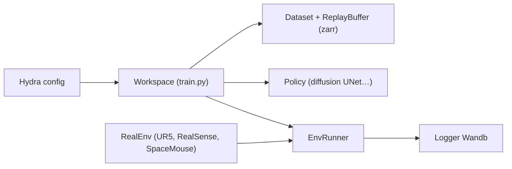

# real-stanford/diffusion_policy

> Research code for learning robotic control policies by diffusion, in simulation and on a robot.

## The problem
Learning robot motions from demonstrations with policies able to represent several behaviors.

## What it actually does
An architecture separates tasks (`Dataset`, `EnvRunner`) from methods (`Policy`, `Workspace`) so that only O(N+M) code has to be written. Training goes through Hydra (`train.py`), data through a zarr `ReplayBuffer`, and multi-seed runs through Ray. The repo provides published checkpoints, Colab notebooks, and a real-time pipeline with UR5, RealSense and SpaceMouse via shared memory.

## How it is wired


## Trying it
```bash
mamba env create -f conda_environment.yaml
conda activate robodiff
wandb login
python train.py --config-dir=. --config-name=image_pusht_diffusion_policy_cnn.yaml training.seed=42 training.device=cuda:0
```

## Cost and gotchas
Linux with an Nvidia GPU and Wandb; MuJoCo requires system packages. The real robot demands specific hardware (UR5, RealSense D415, SpaceMouse). Last push on 2024-12-24: a barely active repo.

## What it is not
Not a generic installable library: it is a repo for reproducing paper results. Multiprocessing through `fork` causes problems with some OpenGL environments.

## Alternatives
No alternative named in the README.

## For you
Worth watching: a useful reference for understanding imitation learning with diffusion, but poorly maintained and reserved for those with a robotics bench.
