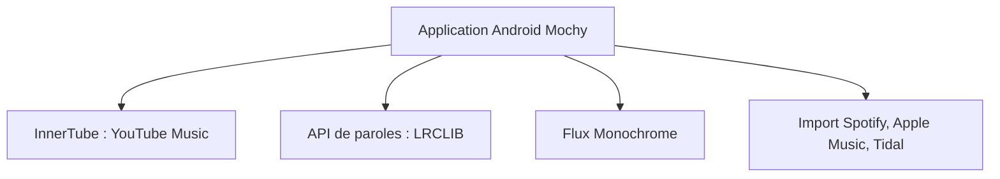

# realidkroo/Mochy-Music

> Open-source Android music player, in beta, plugged into third-party streaming services.

## The problem
Android music players are often proprietary or collect data, and depend on a single service.

## What it actually does
Search, playback, lyrics and downloads without an account. Signing in is used to sync YouTube Music, import playlists from Spotify, Apple Music or Tidal, and show Discord status. The app is a fork of ViviMusic and relies on InnerTube, LRCLIB and other third-party APIs.

## How it is wired
Simplified diagram based on the fiche, no diagram provided.


## Trying it
```bash
git clone https://github.com/realidkroo/mochy-music.git
cd mochy-music
./build.sh --debug -i
```

## Cost and gotchas
Free; build with Android Studio (JDK 21, SDK 36, NDK 27) and about 10 GB of disk. Third-party services may go down or change. Download the APK only from the repository's releases.

## What it is not
It is not an official YouTube or Spotify service. It hosts no music. The beta may contain bugs.

## Alternatives
ViviMusic, Metrolist, SimpMusic, Archivetune and RiMusic, cited as bases or inspirations.

## For you
Ignore: unrelated to data / AI / MLOps work, and the use of third-party streams raises terms-of-service questions.
