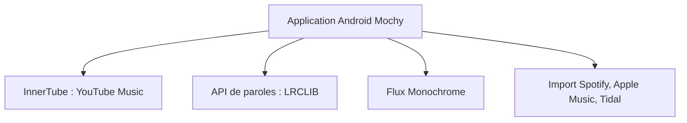

# realidkroo/Mochy-Music

> Lecteur de musique Android open source, en bêta, branché sur des services de streaming tiers.

## Le problème
Les lecteurs musicaux Android sont souvent propriétaires ou collectent des données, et dépendent d'un seul service.

## Ce que ça fait vraiment
Recherche, lecture, paroles et téléchargements sans compte. La connexion sert à synchroniser YouTube Music, importer des listes Spotify, Apple Music ou Tidal, et afficher le statut Discord. L'application est un fork de ViviMusic et s'appuie sur InnerTube, LRCLIB et d'autres API tierces.

## Comment c'est branché
Schéma simplifié d'après la fiche, sans diagramme fourni.


## Essayer
```bash
git clone https://github.com/realidkroo/mochy-music.git
cd mochy-music
./build.sh --debug -i
```

## Coût et pièges
Gratuit ; compilation avec Android Studio (JDK 21, SDK 36, NDK 27) et environ 10 Go de disque. Les services tiers peuvent tomber ou changer. Télécharge l'APK seulement depuis les releases du dépôt.

## Ce que ce n'est pas
Ce n'est pas un service officiel de YouTube ou Spotify. Il n'héberge aucune musique. La bêta peut contenir des bogues.

## Alternatives
ViviMusic, Metrolist, SimpMusic, Archivetune et RiMusic, cités comme bases ou inspirations.

## Pour toi
À ignorer : sans rapport avec un travail data / IA / MLOps, et l'usage de flux tiers pose des questions de conditions d'utilisation.

