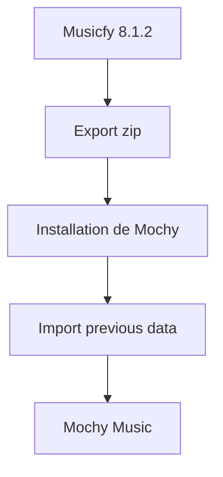

# realidkroo/musicfy

> Transition repository for the Android app Musicfy, renamed Mochy Music, for its former users.

## The problem
The change of application identifier prevents Android from updating Musicfy to Mochy and reading its data.

## What it actually does
It only remains for version 8.1.2, which exports the whole library as a `.zip`, downloads Mochy and opens the installer. Logins (YouTube Music, Spotify, etc.), the streaming cache, the chosen music folders and the playback queue are not migrated. Nothing new is published here anymore.

## How it is wired
Simplified diagram based on the sheet, no diagram provided.

## Trying it
No documented command: the migration is done inside the application (Settings, Move to Mochy Music).

## Cost and gotchas
Free. Allow "Install unknown apps" for Musicfy. The import needs as much free space as the `.zip`. Only download from the official GitHub releases.

## What it is not
Not the active project: that one is called realidkroo/Mochy-Music. Repository archived on the day it was created.

## Alternatives
realidkroo/Mochy-Music, cited in the README, is the successor.

## For you
Ignore: a simple migration page for an Android music application, unrelated to your field.
