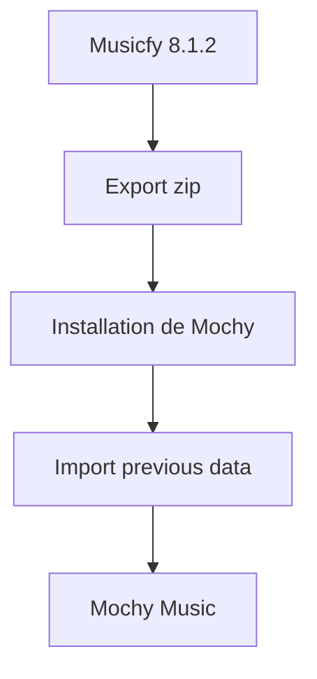

# realidkroo/musicfy

> Dépôt de transition de l'application Android Musicfy, renommée Mochy Music, pour ses anciens utilisateurs.

## Le problème
Le changement d'identifiant d'application empêche Android de mettre à jour Musicfy vers Mochy et de lire ses données.

## Ce que ça fait vraiment
Ne reste que pour la version 8.1.2, qui exporte toute la bibliothèque en `.zip`, télécharge Mochy et ouvre l'installateur. Les connexions (YouTube Music, Spotify, etc.), le cache de streaming, les dossiers de musique choisis et la file de lecture ne sont pas migrés. Plus rien de nouveau n'est publié ici.

## Comment c'est branché
Schéma simplifié d'après la fiche, sans diagramme fourni.

## Essayer
Aucune commande documentée : la migration se fait dans l'application (Settings, Move to Mochy Music).

## Coût et pièges
Gratuit. Autoriser « Install unknown apps » pour Musicfy. L'import demande autant d'espace libre que le `.zip`. Ne télécharger que depuis les releases GitHub officielles.

## Ce que ce n'est pas
Pas le projet actif : celui-ci s'appelle realidkroo/Mochy-Music. Dépôt archivé le jour de sa création.

## Alternatives
realidkroo/Mochy-Music, cité dans le README, est le successeur.

## Pour toi
À ignorer : simple page de migration d'une application musicale Android, sans rapport avec ton métier.

